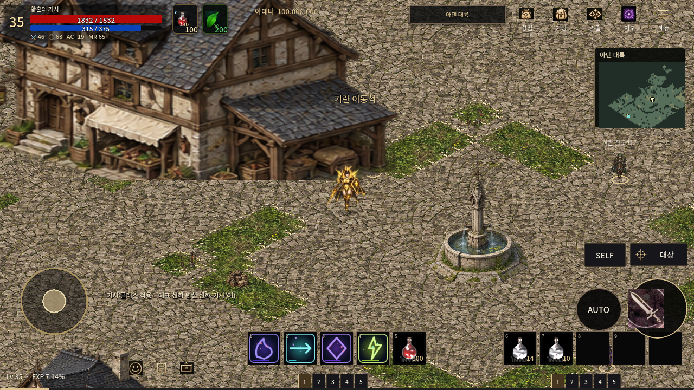

# 기란 실제 화면 1차 비교

**원작 외형 일치: FAIL · 정확한 원작 카메라 정합: NOT_RUN · Android 실기기: NOT_RUN**

| 리니지M 실제 참고 화면, 2017 | TWILIGHT 실제 Main, Godot 4.7.2 |
| --- | --- |
|  |  |

왼쪽은 [Inven 헤라마, 2017-06-25](https://www.inven.co.kr/board/lineagem/5056/392)의
게임 화면이며 붉은 표시는 원 게시물의 표시다. 오른쪽은 이번 브랜치의
실제 Godot 실행 PNG다. 생성 이미지나 과거 PR의 화면으로 대체하지 않았다.
위 표는 원본 이미지 비율을 유지한다. 동일한 1280×720 패널로 나란히 배치한
PNG도 이 작업의 사용자 제출 자료로 생성했지만, 원작 카메라의 정확한
좌표/줌을 확인하지 못했으므로 '동일 카메라 검증 통과'라고 부르지 않는다.

원작 건물·기념주·화단·캐릭터 비율에 차이가 남는다.
[항목별 차이](REFERENCES_AND_DIFFERENCES.md)와 [검증 범위](README.md)를 확인한다.
다른 지역의 그래픽 제작과 main 병합은 진행하지 않는다.

원작 이미지는 비교 출처 URL로만 연결하며 게임 타일/오브젝트로 포함하지 않았다.
추가 참고 화면의 출처·해시는 [REFERENCE_MANIFEST.json](REFERENCE_MANIFEST.json)에 있다.
