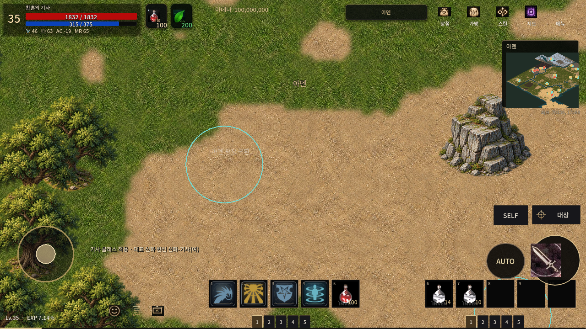
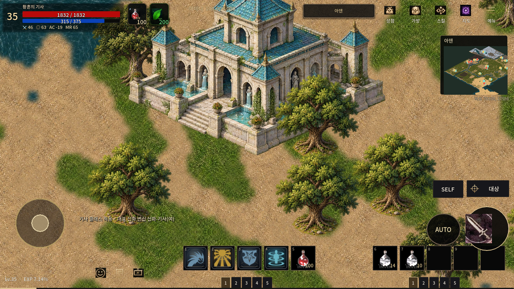
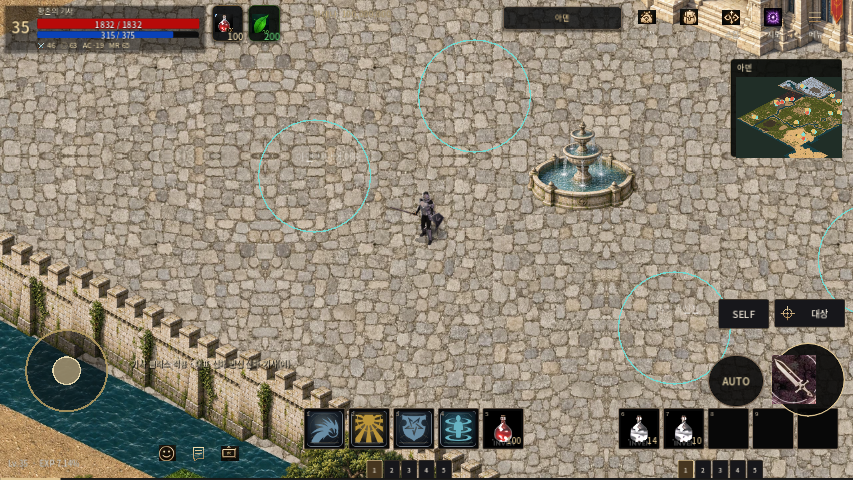

# 아덴 전체 신규 원화의 스트리밍 적용 준비 — 2026-10-24

기존 신규 PNG 초안의 RGB를 확대하지 않고 같은 신규 원화·배치 데이터에서 지면과 전경을 분리해 배포 자산을 만들었다. 전체 비공백 지형을 실제 `NativePngRenderer` 기본 경로에 연결했다. **실행 가능한 전체 범위 아트이지만 전 지역 지리·충돌 정밀 검수가 끝난 최종 지도나 출시 APK는 아니다.** 기존 PNG 및 다른 PR 변경은 보존한다.

## 크기와 적용 범위

|항목|측정값|
|---|---:|
|보존한 전체 초안 PNG 120장|3,290,945,321 bytes|
|월드 경계|원점 (11802,2214), 72240×45708 world units|
|비공백 지형 / 배포 적용 면적|1,471,232,592 world units² / 동일 전체 범위|
|지면|5,892개, 최대 512×512 WebP Q90|
|전경|50개 고유 무손실 WebP, 15,583개 배치|
|배포 이미지 payload|664,731,748 bytes (원본 PNG의 20.20%)|
|manifest 포함 폴더|667,357,855 bytes|
|Godot supplemental PCK 실측|668,038,896 bytes, 5,945 files|
|APK/AAB 크기|미측정; 로컬 Android build-tools 없음|

실제 픽셀 밀도는 **1 image pixel/world unit**, 카메라 zoom 1에서 1:1이다. 기존 개요도는 1픽셀이 6 world units에 펼쳐졌다. 지면 압축은 손실 압축이므로 무손실이라고 하지 않는다. 4개 대표 1024² 원화 crop의 Q90 RGB PSNR은 32.71~37.51dB였다. Q80/90/95 비교는 `evidence/compression.json`. 전경 알파/색상은 무손실이다. 전경은 발 기준 y-sort로 분리했다. 각 전경 인스턴스의 GPU 텍스처는 현재 별도이며, 디스크의 원화만 공유한다.

기존 import의 ETC2/ASTC 설정은 유지한다. 이 경로는 기존 `*.bin` export include로 WebP 바이트를 싣고 `Image.load_webp_from_buffer`로 디코딩한다. **WebP 디스크 압축이며 GPU ETC2/ASTC 압축이 아니다.** 디코딩 후 RGBA 텍스처가 된다. 3.29GB 초안 폴더는 기존 export exclude에 남긴다. 모든 이미지를 import하거나 읽지 않고 현재 화면+여유 영역만 공간 인덱스로 찾고 worker 1개에서 디코딩, 프레임당 1개 업로드한다. Android 기존 48MiB 지도 텍스처 예산을 공유한다. 원본 이미지가 없는 export에서도 기존 지형 메타데이터와 통행 데이터를 사용한다.

## 실제 대조와 수정

대표 대조는 궁전의 기존 고정 등록 위치, 신전/수변, 서부 산지 **3개 구역**이다. 전체 120개 패널의 세부 지리 검수 완료를 뜻하지 않는다. 참고 PNG SHA `c0af339cbc2dbba5fb2e65c3c7f01d9467507545d7b91cbb331f5bbd51128730`. 원본 RGB는 분류 판단에만 쓰고 출력에 복사하지 않았다.

- 신전 발 위치 source (10550,4330) → (10410,4305). 기존 그림의 안뜰을 덮던 배치를 바로잡았다.
- 신전 파란 지붕을 물로 오분류한 176 semantic cells를 수정했다.
- source (5100,2300,1500,900) 산지의 직선 다각형 경계를 기존 능선 명암에 맞췄다. 두 분류 수정을 합해 91,741 semantic cells 변경.
- 기존 18개 명시 충돌 위치에 기존 분수와 신규 물체 17개를 대응시켰다. 충돌 데이터 자체는 변경하지 않았다.
- 발 아래 통행 가능 셀과 겹치는 장식 21개, 원본 근거 없는 신전 안뜰 바위 4개를 배포 배치에서 제외했다. 이전 PNG/배치 원본은 삭제하지 않았다.
- 최종 15,583개 배치 중 기존 명시 충돌/분수 제외 하단 22%의 5개 열에서 44,642개 알파 접촉 샘플을 검사해 알려진 통행과의 교차 0개. 이는 모든 건물 전체 윤곽·가려진 공간의 물리 검수 완료가 아니다.

수정 좌표·제외 이유는 `tools/map_restore/aden_mobile_review/`에 보존한다. 기존 통행 밖의 공간을 임의로 열거나 막지 않았다. 따라서 원화가 열린 평지처럼 보여도 기존 보수적 통행 경계 때문에 못 걷는 곳이 남을 수 있다. 이 잔여 문제를 해결하려고 보이지 않는 새 장애물을 추가하지 않았다.

## 동일 조건 PC 비교

Godot 4.7.2, Linux llvmpipe OpenGL, 1280×720, zoom1, 같은 7개 카메라 위치/순서, 몬스터 제거, 48MiB 지도 정책, 별도 빈 저장 디렉터리. 각 1회 측정이며 전투 FPS 시험이 아니다. 새/기존 경로 모두 이동 중 메인 스레드 디코딩 0, 38개 포탈 접근 유지, 스폰/통행 스냅샷 불변이다.

|측정|기존 확대 PNG + 작은 광장|신규 전체 지도|
|---|---:|---:|
|Main 생성 및 아덴 필드 진입|6586ms|6347ms|
|7개 구역 표시 완료 시간|0~141ms|205~559ms|
|총 디코딩 자산|13|176 (21,475행 중 일부)|
|지도 텍스처 최고 계산량|43,000,360 bytes|50,320,264 bytes (48MiB 한도 이하)|
|최장 자산 디코딩 CPU 시간|36.611ms|24.125ms|
|전체 프로세스 peak RSS|1,319,924KiB|1,452,548KiB|

고해상도 청크/전경 수 증가로 표시 완료 시간과 프로세스 메모리는 늘었다. 텍스처 수치에는 GPU 드라이버·CPU 디코딩·게임 전체 메모리가 포함되지 않으므로 전체 RSS와 분리했다. 새 지도는 7개 이동 중 한 번도 전체 payload를 읽지 않았다. 캐시 해제/재입장도 통과했다. 실제 Android 장치, 장시간 이동·전투, GPU 드라이버 메모리, APK 설치·실행은 **미측정**이다. 큰 모바일 팩의 배포 채널/다운로드 방식은 추가 판단이 필요하다.

## 검증과 재현

- `python3 tools/map_restore/verify_aden_mobile.py`: 5,943개 payload 바이트/SHA/치수 전수 통과. manifest SHA는 `data/maps/aden_mobile_pack.json`에 고정. Windows autocrlf에서 바뀌지 않도록 `.gitattributes`에 명시했다.
- `tests/aden_mobile_streaming_test.gd`: 실제 Main의 7개 지역, 1280×720/854×480 화면, worker/메모리/포탈/스폰 검사 PASS. 기존 비교는 `-- --legacy-aden-world-art`.
- `tests/aden_live_plaza_test.gd`: 보행/분수/포탈/캐시 해제·복귀/통행 불변 PASS.
- 마지막 선택 통합 import, boot, native_png_route_recovery, original_based_spear_captain_gameplay **4/4 PASS**, skip0. 후자는 실제 Main 1,500검사 PASS.
- 실제 전경 가림 검사: 분수 뒤 캐릭터 노출 2,270pixels, 앞 3,010pixels. 신규 분리 전경에서 y-sort 통과.
- Windows autocrlf 실제 임시 checkout에서 manifest SHA 일치 PASS.
- 원본 리소스 장부 검사 723 atlases/41,442 frames PASS. 전체 원본 통합 주장이 아니다.
- PCKPacker로 로컬 PCK를 만들고 실제 `load_resource_pack` 후 5,943 payload SHA 재검사 PASS. PCK는 대용량 단일 파일이므로 Git에는 개별 자산과 재현 스크립트를 보존한다. APK 전달을 뜻하지 않는다.

재생성 순서: `build_aden_mobile.py` → `tests/audit_aden_mobile_feet.gd` → `finalize_aden_mobile.py` → `audit_aden_mobile_feet.gd -- --final-mobile-feet` → `verify_aden_mobile.py`. 빌더는 좌표 분류 검토용 기존 `/workspace/map-originals/Aden.png`가 필요하다. 기존 원본 파일을 변경하지 않는다. 감사 출력 기본 경로는 `/workspace/aden-mobile-evidence/`이다.

패키지 재현: `ADEN_MOBILE_PCK=/path/aden-mobile.pck godot --headless --path . --script res://tools/map_restore/package_aden_mobile.gd`. 기본 export preset은 새 `.bin`과 manifest를 포함하고 큰 draft PNG는 제외한다. 대용량 추가 배포 팩을 실제 설치 경로에 쓸 경우 앱 패키징/다운로드 처리는 별도다.

Library 인증 차단은 재시도/우회하지 않았다. 아래 이미지·코드·배포 payload는 이 PR의 Git 파일로 전달한다. main 병합·배포는 하지 않는다.

## 실제 적용 화면

