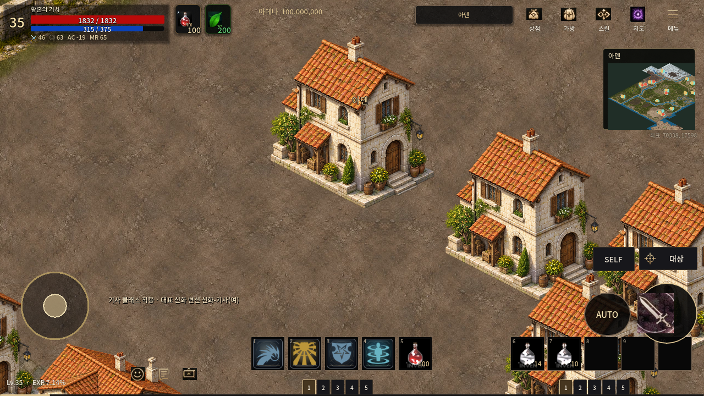
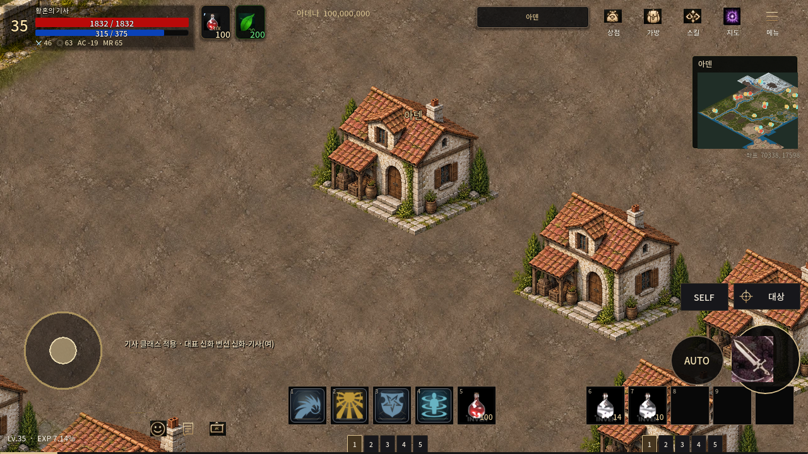
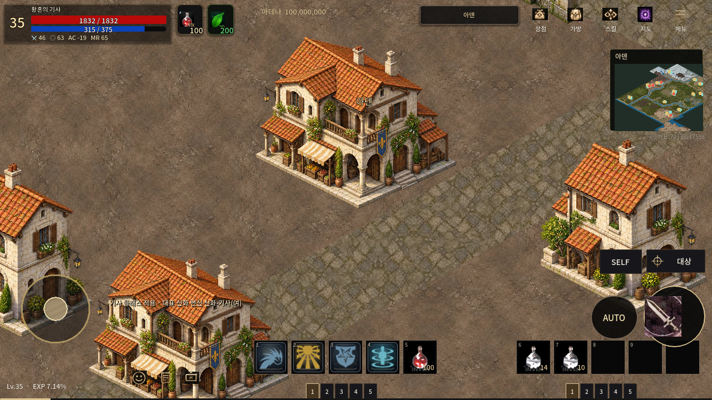
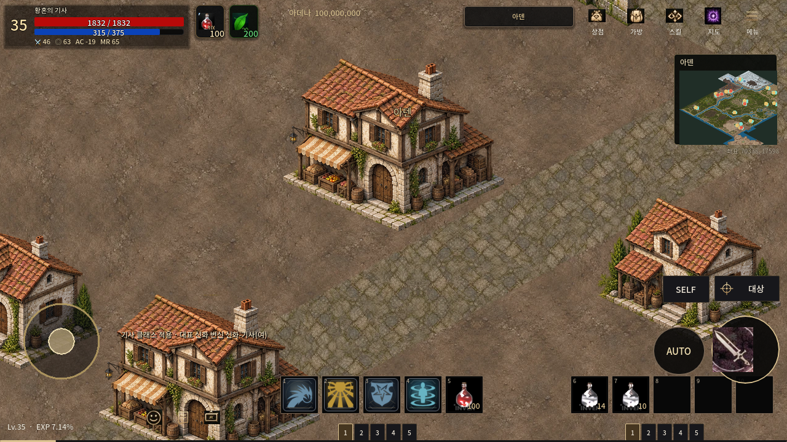
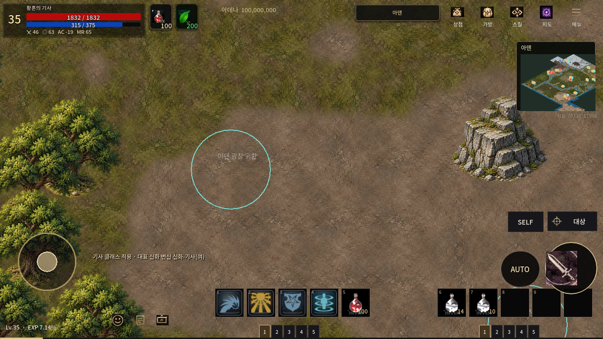
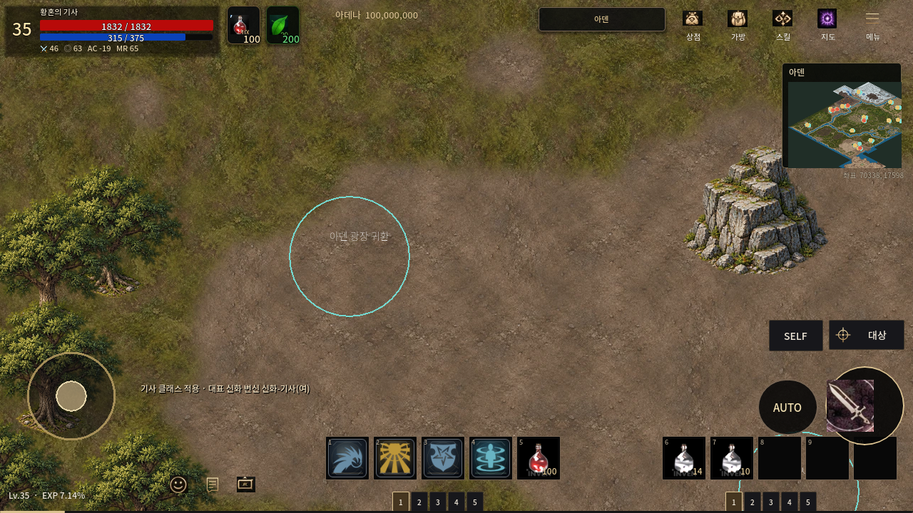
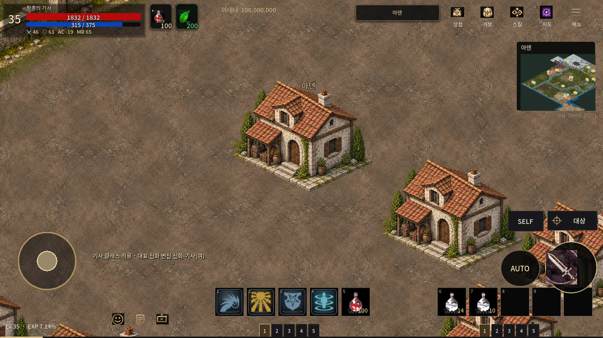
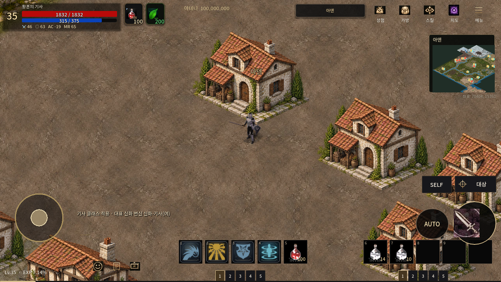
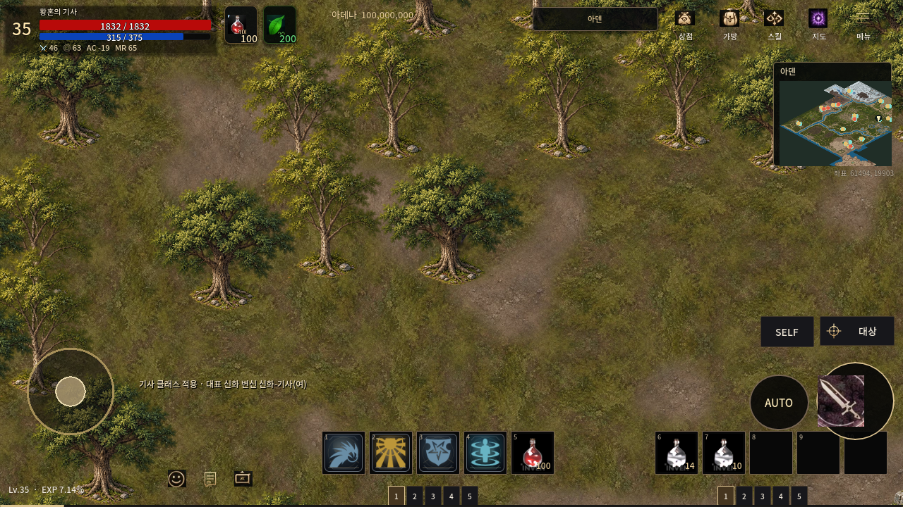
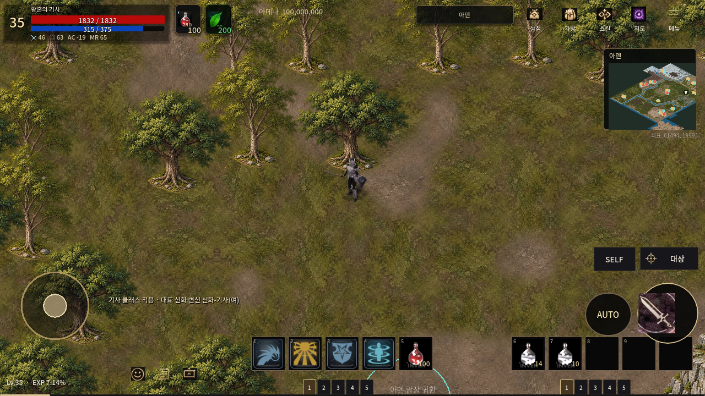

# 아덴 공통 건물·수목 원화 개선과 PR155 재개 검증

2026-10-25 재개 기준: main `cba19558`, PR155 원격 `9e7adf4e`. 로컬 미완성 원화는 stash로 보존한 뒤 **동일 PR 브랜치를 fast-forward**했다. f7432d2a 이후 PR156 통합과 검수된 polygon 충돌 교체를 모두 유지했다. 이번에 main/다른 PR를 병합한 것이 아니다. PR122 원화·모션·프레임·발 기준점·공격 마커, 공통 UI/VFX 파일은 변경하지 않았다.

## 원화와 비례

직전 공통 바닥 개선을 유지하고 가장 많이 쓰이는 나무 2종, 주택, 상점 원화를 이미지 생성 도구로 다듬었다. [실제 기란 화면](https://lineagem.plaync.com/board/free/view?articleId=65143adae08a821fd62f20c9) 및 [필드 사냥 화면](https://lineagem.plaync.com/board/image/view?articleId=5cc99ae791196a0001d259d8)의 낮은 건물 실루엣·문 대비 지붕 비율·줄기와 잎 사이 여백을 참고했다. 원작 RGB는 복사하지 않았다. 기존 자체 제작 atlas를 편집한 PNG 원본과 재현 컴파일러를 Git에 보존한다.

|공통 원화|기존 → 새 렌더 치수|적용 개수|
|---|---|---:|
|참나무|210×212 → 210×191|8,588|
|가벼운 수관의 나무|210×214 → 167×214|4,439|
|도시 수목(같은 원화)|210×214 → 167×214|250|
|주택|300×314 → 300×238|66|
|상점|360×313 → 360×281|26|

합계 **13,369개** 배치에 적용했다. 새 그림을 기존 사각형에 찌그러뜨린 것이 아니라 새 원화 종횡비를 유지해 균등 축소한다. 주택은 낮은 다락층·커진 문/창 비례, 상점은 낮고 넓은 실루엣·절제된 장식으로 바꿨다. 나무는 줄기가 드러나고 수관에 빈틈이 생기도록 수정했다. 원화 파일 크기 상한은 기존 렌더 사각형이며 해상도/카메라 배율을 낮추지 않았다.

**전체 15,583개 world foot 좌표와 ID·개수, 5,892개 지면 청크는 완전히 동일**하다. 새 높이에 맞춰 그림의 좌측 상단 위치만 재등록했다. 기존 충돌·포탈·스폰은 수정하지 않았다. 최초 검사에서 `city_forest_tree_146`의 새 뿌리 2개 샘플이 알려진 통행과 겹쳐, 그 한 개체는 기존 그림과 위치를 유지했다. 개체를 삭제하거나 길을 막지 않았다. 이 예외로 고유 전경 파일은 50→51개다.

최신 NativePngField에서 하단22%/5열의 접촉점 **49,305개**, 알려진 통행과의 교차 **0**. 전체 알파 윤곽과 모든 가려진 통행의 정밀 검수를 대체하지 않는 제한된 검사다.

## 실제 전후 화면

현재 `9e7adf4e` 기반의 같은 코드·1280×720·zoom1에서 이전/신규 자산 PCK만 바꾸어 캡처했다. 지리와 카메라 좌표는 같다. 아래 주택은 source(11734,2551), 상점(12020,2638), 숲(10290,3395)이다.

|주택 이전|개선 후|
|---|---|
|||

|상점 이전|개선 후|
|---|---|
|||

|숲 이전|개선 후|
|---|---|
|||

실제 캐릭터 대비 크기와 전경 가림은 아래 별도 검사에서 확인했다. 근처 다른 전경의 영향을 피하도록 등록된 숲 나무를 선택했다. 가림 검사는 캐릭터를 강제로 앞/뒤에 배치하는 시각 QA이며 실제 보행 경로 증거로 사용하지 않는다.

|주택 뒤|주택 앞|
|---|---|
|||

|나무 뒤|나무 앞|
|---|---|
|||

## 배포 크기와 같은 조건의 비교

|항목|이전|이후|
|---|---:|---:|
|이미지 payload|517,236,636 bytes|517,206,498 bytes|
|실제 PCKPacker 출력|520,540,912 bytes|520,511,168 bytes|
|최대 지도 텍스처 RGBA 계산량|50,331,264 bytes|50,326,560 bytes|
|9개 구역 표시 완료 시간|201~651ms|276~601ms|
|Main+필드 진입|8180ms|8124ms|
|최장 개별 디코딩 CPU|22.294ms|19.437ms|
|디코딩 자산 수|219|215|

PC llvmpipe, Godot4.7.2, 1280×720, zoom1, 동일9개 좌표·순서·48MiB 지도 정책, 두 PCK를 순차 각1회 비교했다. 새 자산의 표시 범위가 줄어 일부 가시 행 수가 달라지지만 개체 수는 같다. **성능 개선을 통계적으로 입증한 측정이 아니다.** 양쪽 모두 이동 main-thread decode0, 실패0, 포탈38/통행/스폰 불변, 전체 eager load 없음이다. 48MiB(50,331,648 bytes) 한도를 유지했다. 지도 텍스처 계산량을 전체 RAM/GPU 드라이버 메모리로 해석하지 않는다. 실제 Android 기기·APK 설치·전투 FPS는 미측정이다.

## 최신 재검증 및 CI 보존

- 현재 리소스 검사: 723 atlas / 41,442 frames PASS. 새 배포 payload 5,944개의 SHA/치수 검사와 PCK 재로딩 SHA PASS.
- 기존 8개 집중 검사 최종 PASS: import, boot, ground_drop_smoke, road_surface_mesh(316), original_based_spear_captain_gameplay(1490), reference_expansion(25맵/436), aden_mobile_streaming, aden_mobile_occlusion. skip0.
- 최초 렌더3개 실패는 재개 환경의 X11 부재였다. 시스템 PATH의 Xvfb도 없었으나 기존 `/workspace/tooling/xvfb/usr/bin/Xvfb`를 사용해 복구했다. 실패 로그와 성공 재검사를 함께 보존한다. 단언을 삭제/완화하지 않았다.
- 원격 occlusion의 `_OK/_FAILED` 판정기 계약과 로컬의 분수·주택·나무 앞/뒤 검사를 함께 유지해 충돌을 해결했다. 판정기 파일은 변경하지 않았다.
- ground_drop 좌표, reference_expansion 텍스처 계약, ordinary-game rg 의존성, Windows 맵 정의 SHA 보정은 이미 최신 원격에 있었다. 중복 수정하지 않았다. 실제 autocrlf checkout에서 맵 정의3개 SHA도 PASS. 실제 Windows OS 실행은 원격 CI 결과와 별개다.
- 최신 기준9e7adf4e의 원격 CI는 별도로 조회했으며 전체 완료를 주장하지 않는다. 이번 작업은 `[skip ci]` 저장으로 전체 CI를 추가 실행하지 않고 최종 통합 단계에서 한 번 수행하도록 남긴다.

## 전달과 남은 범위

`tools/map_restore/aden_object_style/objects.png`와 provenance가 새 원화, `refine_aden_objects.py`가 재현 도구다. 원화 제작 전의 파일과 이전 PNG 3.29GB는 Git 이력/기존 경로에 보존한다. 재현 순서는 이전 mobile/style 빌드 후 `refine_aden_objects.py`, 발 감사, `verify_aden_mobile.py`, PCK 검사다.

이번 공통 건물·수목 시각 개선은 적용했으며, 모든 궁전·교량·기념물·설원 수목을 다시 그린 것은 아니다. 전체 지리/자동 분류/가려진 통행의 정밀 검수 및 Android 실기 확인은 남는다. PR 설명 갱신은 지시에 따라 시도하지 않았고 Library 인증 경로도 우회하지 않았다. main 병합·배포는 하지 않았다.
