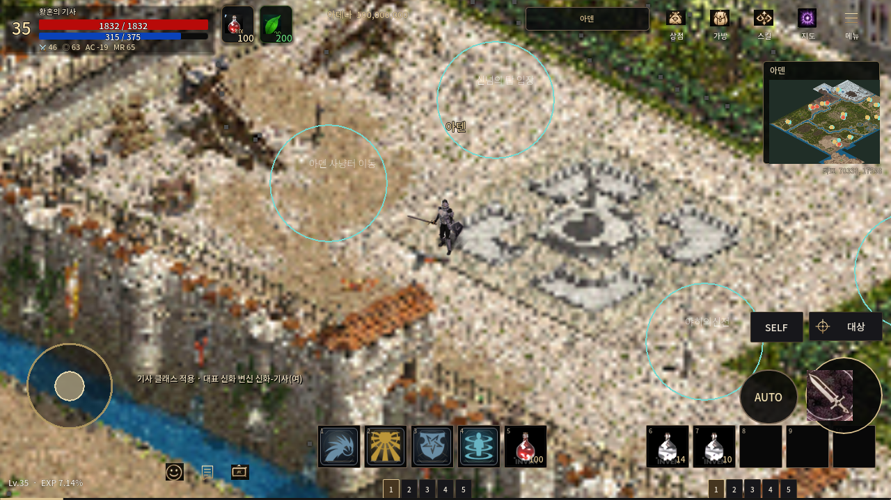
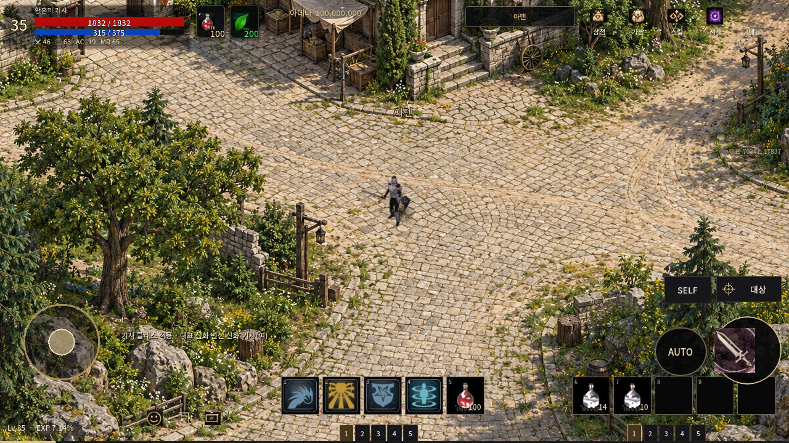
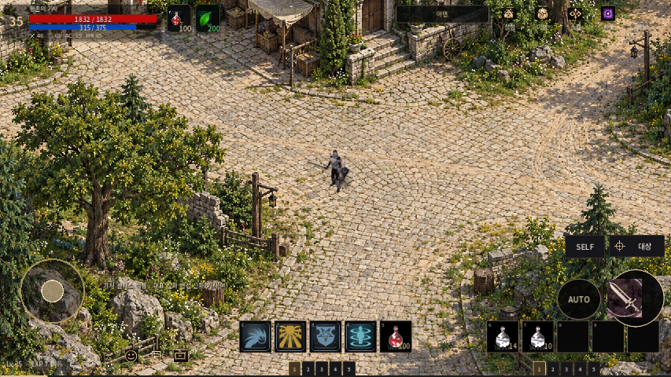

# 아덴 신규 PNG 첫 구역

사용자 최신 지시에 따라 원본 확대/충돌 보정 작업과 별개로 **새 미술 자산**을 제작했다. 기존 PNG를 참조 입력·업스케일·샤프닝하지 않은 신규 이미지 생성 결과다.

- [새 PNG](../../assets/maps/aden_rebuild_preview/town_forest_01.png): 1536×1024, 약 4.3MiB PNG.
- 기존 아덴: 1 source pixel = 6 world units, 기본 카메라의 논리 화면 폭1280에 원본 약213px. 큰 전체 개요도를 넓은 월드에 펼친 것이 흐림의 원인이다.
- 샘플: **1 texture pixel = 1 world unit**, 선형 밀도6배/면적 밀도36배. 기존 캐릭터 크기와 기본 카메라 배율 유지. 854×480 화면은 게임의 기존 viewport stretch를 그대로 사용한다.
- 대표 구역: 석조 마을 가장자리·광장·길·숲. 같은 시점/광원을 요구해 신규 제작했고 실제 Main에 일시 적용해 비교했다.
- 생성 원본은 보존하고, 현재 아덴 월드 경계/원본/신념/에스카로스/번개/CI 복구 변경은 그대로 유지했다. 일반 게임 시작 시 이 샘플로 바뀌지 않는다.

## 실제 적용 화면

| 기존 | 신규 PNG 미리보기 |
| --- | --- |
|  |  |
|  |  |

실제 Godot 4.7.2 Main/캐릭터/HUD를 사용한 PC OpenGL 화면이다. 새 구역에서는 잘못된 전체 지도처럼 보이지 않도록 기존 미니맵만 숨겼다. 전체 월드에 배치가 완료된 화면이나 Android 실기 결과가 아니다.

## 이동과 메모리

샘플 그림에서 보이는 포장도로/흙길을 수동으로 따라 street polygon을 작성했다. 길 위 240px 실제 캐릭터 이동, 4개 출구 경로, 건물/수목/바위 영역 제외 검사를 수행했다. 이 마스크는 샘플 길의 통행 확인용이며 모든 수관 아래/건물 내부까지 완성된 충돌 지도는 아니다.

엔진에는 원본을 512×512의 6개 텍스처로 분할해 1:1 배치했다. 청크당 RGBA 1MiB, 모두 합쳐 6MiB. 분할된 이미지들을 다시 합친 전체 픽셀이 생성 원본과 일치하는지 검사해 경계의 크롭 누락/겹침/재표본화를 배제했다. 원본 디코드 중에는 추가 일시 이미지 메모리가 있으며 6MiB를 앱 전체 메모리로 보고하지 않는다.

**인접한 별도 생성 구역 간 미술 이음새는 아직 검사할 두 번째 구역이 없다.** 다음 구역은 동일 축척/광원/시점과 경계 참조로 생성하고 겹치는 가장자리를 검수해야 한다. 나무 수관·지붕의 전경 분리도 다음 단계다.

현재 전체 월드 72,240×45,708을 1px/world로 모두 고유하게 그리면 약33억 픽셀이므로 거대 단일 텍스처 방식은 사용하지 않는다. 다음 제작에서는 실제 이동 구역 우선 고밀도 PNG와 시야 기반 청크 로딩, 전체 저장 용량 예산을 함께 설계해야 한다. 이번 6청크 미리보기는 그 전체 스트리밍 시스템을 완성한 것이 아니다.

재현: `ADEN_NEW_ART_OUTPUT=<absolute directory>`와 화면이 있는 DISPLAY에서 `--script res://tests/capture_aden_rebuild_preview.gd`를 실행한다. isolated XDG_DATA_HOME을 사용하며 production save를 쓰지 않는다. 결과는 evidence/result.json에 기록한다.

첫 미리보기 검사 12/12 PASS. 기존 리소스 723atlas/41,442프레임 무결성 검사 PASS. 전역 게임 코드를 변경하지 않았으므로 이 단계에서 전체 CI를 반복하지 않았다.
