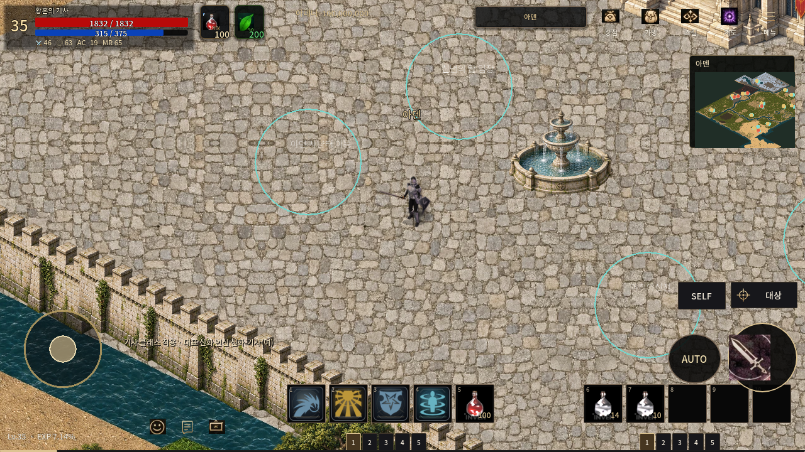
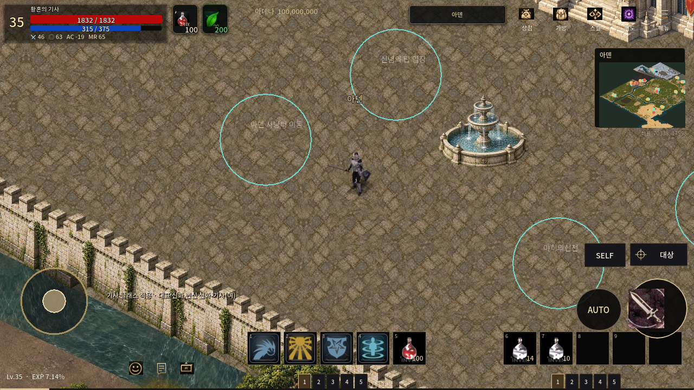
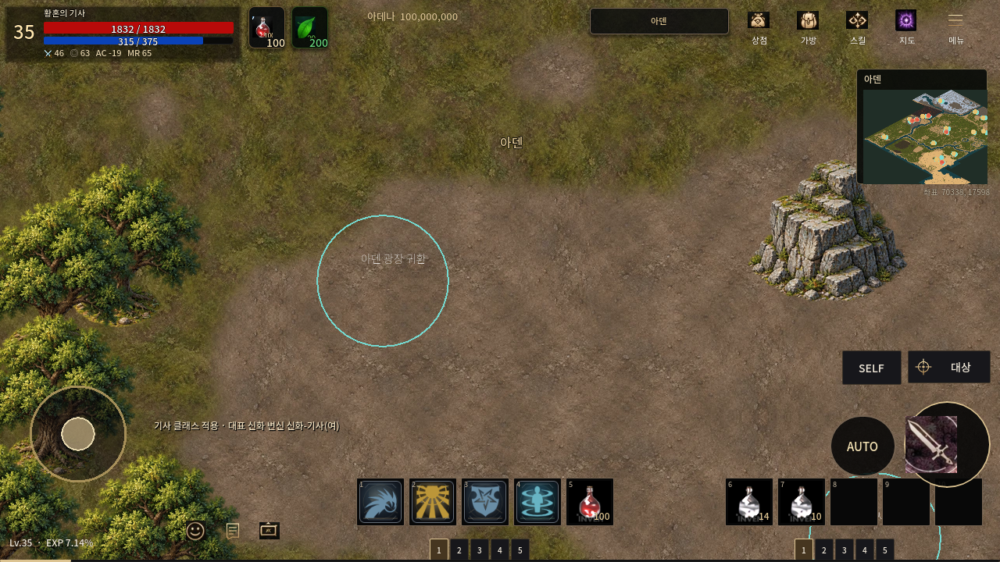
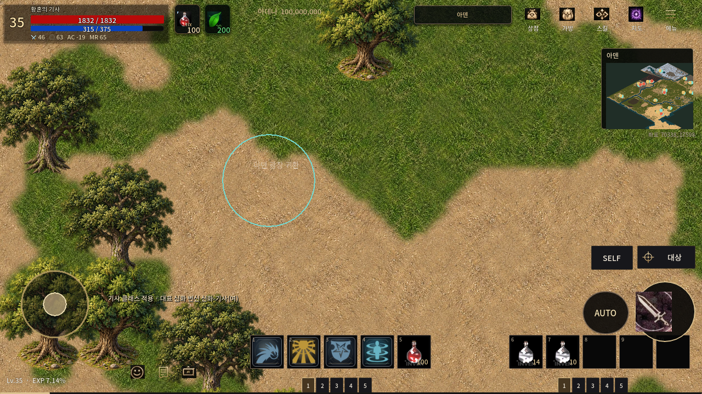
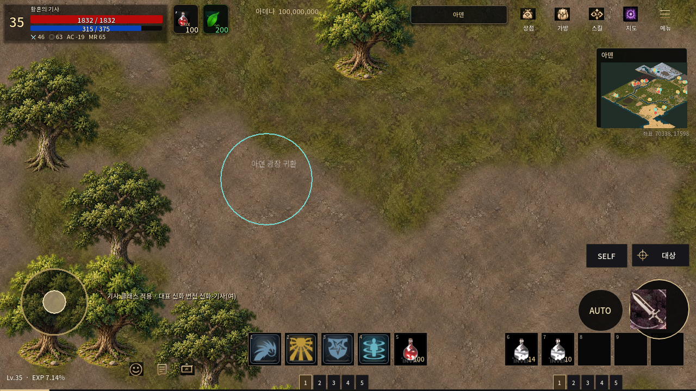

# 아덴 공통 바닥 원화 개선 — 2026-10-24

전체 신규 지도와 1px/world-unit, 512px 스트리밍을 유지하며 도시·숲·사냥터가 공유하는 포장·잔디·흙·물 원화를 새로 만들었다. 기존 신규 PNG 120장과 건물 원본은 보존한다. 이번 변경은 **공통 바닥의 스타일 개선**이며 건물/수목 원화를 모두 재제작하거나 지리 검수를 끝냈다는 뜻이 아니다.

## 비교 근거와 변경

실제 [리니지M 기란 플레이 화면](https://lineagem.plaync.com/board/free/view?articleId=65143adae08a821fd62f20c9)과 [필드 사냥 화면](https://lineagem.plaync.com/board/image/view?articleId=5cc99ae791196a0001d259d8)을 열어 확인했다. 포장의 낡은 회갈색, 넓고 낮은 대비의 흙, 식생 사이로 드러나는 지면과 캐릭터를 가리지 않는 전투 공간을 참고했다. 스크린샷 RGB/게임 자산은 복사하지 않았고 원본 참고 파일을 저장소에 넣지 않았다.

- 이미지 생성 도구로 새 원화 atlas를 제작했다. 첫 수정 시안은 기존 밝은 풀 선이 많이 남아 채택하지 않았으며, 새 제작한 두 번째 원화를 사용했다.
- 잔디의 가는 노란 선을 낮은 올리브·이끼 색 덩어리로, 균일한 자갈 바닥을 흙과 드문 돌·낙엽이 보이는 표면으로 바꿨다.
- 도시 포장도 같은 신규 원화에서 구성했다. 기존 512px 거울 반복 대신 전역 좌표를 공유하는 2048px 확률적 패치 패턴을 사용해 작은 반복 문양을 줄였다. 이 패턴은 유한한 재사용 재질이며 반복을 완전히 없앤 것은 아니다.
- 기존 도시 39개 지형 다각형과 전역 분류 데이터는 그대로 사용했다. 풀/흙 재질 혼합 폭만 완만하게 조정했다. 32px halo와 전역 위상으로 청크 경계의 재질 위상을 맞춘다.
- 기존 건물의 등각 시점·발 위치·윤곽을 임의 변형하지 않았다. 건물/수목/소품 15,583개 배치와 원화 50개는 바이트/배치 비교로 보존한다. 수목 밀도를 늘리거나 새 충돌을 추가하지 않았다. 건물 비례와 지역별 랜드마크를 더 정밀하게 다듬는 작업은 남아 있다.

`tools/map_restore/restyle_aden_mobile.py`가 기존 배포 manifest, 수정된 지형 class ID 및 도시 layout으로 일괄 컴파일한다. 모든 출력 청크에서 기존 알파가 그대로인지 확인한다. 원화와 provenance는 `tools/map_restore/aden_style/`에 보존하며 tools 경로는 게임 export 대상이 아니다. 기존 3.29GB 초안은 변경하지 않는다.

## 같은 좌표 전후 화면

1280×720, zoom1, 같은 실제 Main 카메라 좌표다. 카메라를 지역으로 이동시킨 화면이므로 일부 화면에 플레이어가 없을 수 있다. 기존/신규 모두 몬스터를 제거한 시각·스트리밍 검사이며 전투 성능 시험이 아니다.

|도시: source (11720,2934)|개선 후|
|---|---|
|||

|숲: source (10290,3395)|개선 후|
|---|---|
|||

|폐허 사냥터: source (8240,3130)|개선 후|
|---|---|
|||

Android 실기기는 사용하지 못했다. PC llvmpipe 결과와 Android 텍스처 정책 모의 적용을 실제 기기 FPS/메모리로 해석하면 안 된다. Library 인증 경로는 재시도하지 않았다. 새 원화·배포 자산·게임 화면은 Git에 보존한다.

재현은 기존 `build_aden_mobile.py` → 발 위치 감사/`finalize_aden_mobile.py` 이후 `python3 tools/map_restore/restyle_aden_mobile.py` → `verify_aden_mobile.py` 순서다. 현재 manifest에서 다시 실행해도 좌표와 알파는 변하지 않는다. 바이트가 일치하지 않는 출력을 영수증 없이 활성화하지 않도록 최종 manifest와 receipt는 모든 청크 생성 후 함께 갱신한다. 빌드 중인 작업 디렉터리로 게임을 실행하지 않는다.

## 최종 측정과 검사

|항목|d17881e 이전 원화|이번 개선|
|---|---:|---:|
|배포 이미지 payload|664,731,748 bytes|517,236,636 bytes (22.19% 감소)|
|동일 PCKPacker 출력|668,038,896 bytes|520,540,912 bytes|
|청크 / 전경 배치|5,892 / 15,583|동일|
|PCK 비교: Main+필드 진입|6744ms|6244ms|
|PCK 비교: 구역 표시 완료|198~604ms|237~649ms|
|PCK 비교: 최대 지도 RGBA 계산량|50,320,264 bytes|50,330,008 bytes|
|PCK 비교: 최대 개별 디코딩 CPU|27.773ms|24.976ms|
|일반 파일 실행 전체 process peak RSS|1,452,548KiB|1,452,864KiB|

측정은 같은 Godot 4.7.2 / PC llvmpipe / 1280×720 / zoom1 / 7개 지점 / 48MiB 지도 예산이다. 최초 일반 파일 비교에서 표시 지연이 늘어 전후 모두 같은 PCK 형식으로 묶고 별도 빈 저장 경로에서 순차 비교했다. PCK 비교는 각 1회라 통계적 속도 개선을 주장하지 않는다. 숲 604→649ms, 폐허 497→460ms 등 구역별 증감이 섞여 있다. 일반 파일 측정과 PCK 측정은 분리해 보존했다. 위 RSS는 GPU 메모리가 아니며, PCK 비교 RSS를 별도 측정한 값도 아니다. 두 PCK 모두 이동 중 main-thread decode 0, 전체 eager load 없음, 실패 0. 모바일 지도 예산 50,331,648 bytes를 넘지 않았다. 전투 FPS와 실제 Android는 미측정이다.

5,114개 지면 청크의 픽셀이 바뀌었다. 컴파일 중 5,892개 모든 청크의 이전/이후 알파 완전 일치, 전경 원화/배치 완전 일치를 확인했다. `verify_aden_mobile.py`의 5,943개 payload SHA/치수 검사, PCK 재로딩 후 모든 payload SHA 검사 PASS. 실제 Main 스트리밍 검사에서 38포탈 접근·기존 통행/스폰 불변 및 854×480 화면도 PASS. 재질만 바꾸며 물리/캐릭터/번개/신념/에스카로스 코드는 변경하지 않았다. 기존 723 atlas/41,442 frames 리소스 검사도 PASS.

PNG 원화는 `tools/map_restore/aden_style/materials.png`, 실제 게임 적용 바이트는 `assets/maps/aden_world_mobile/`, 새 manifest SHA는 `data/maps/aden_mobile_pack.json`에 있다. 예전 신규 PNG 120장(3,290,945,321 bytes)과 구 배포 자산은 기존 Git 이력에 보존한다. 지도 전체의 정밀 지리/가려진 통행 검수와 건물·수목의 개별 원화 다듬기는 여전히 남아 있다. 이번에는 공유 지면 개선을 완료했다.
