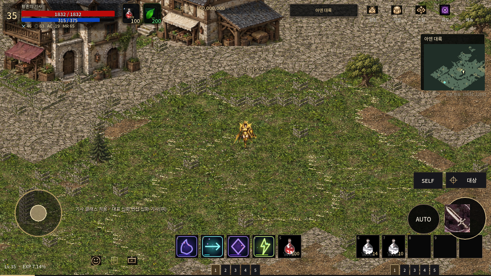
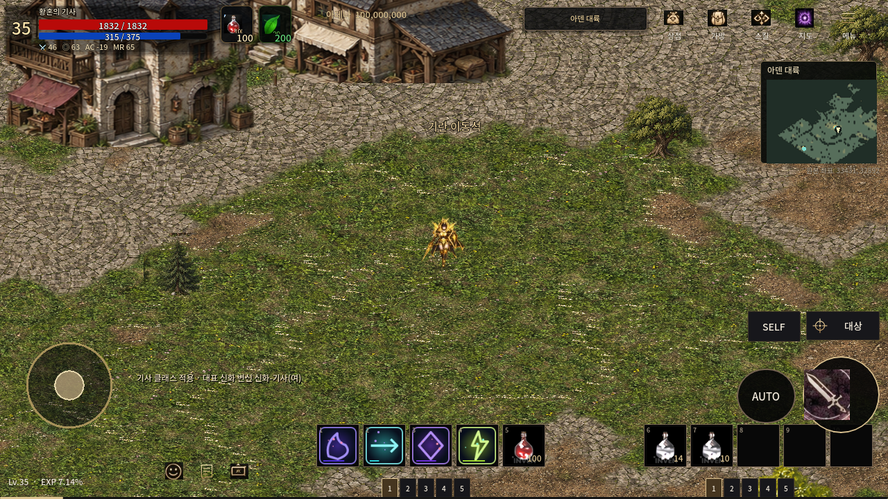
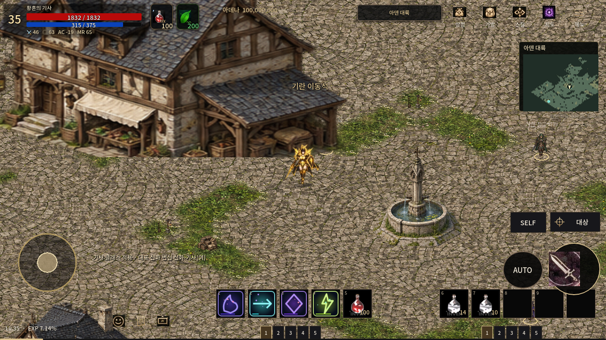
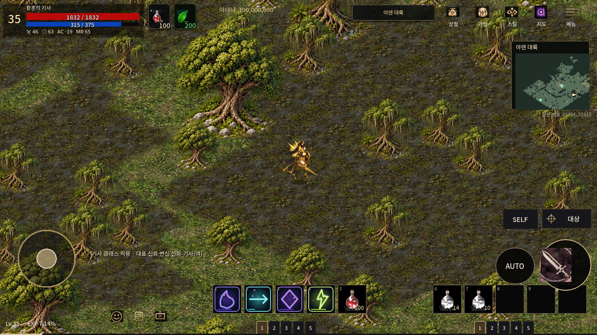
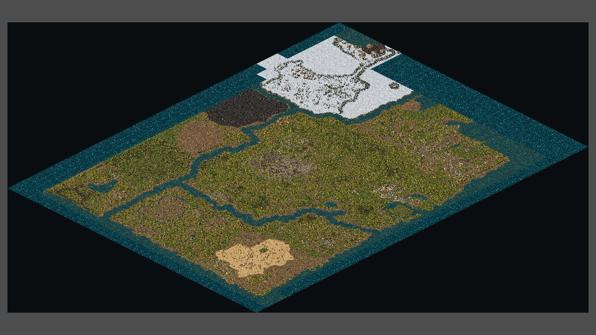
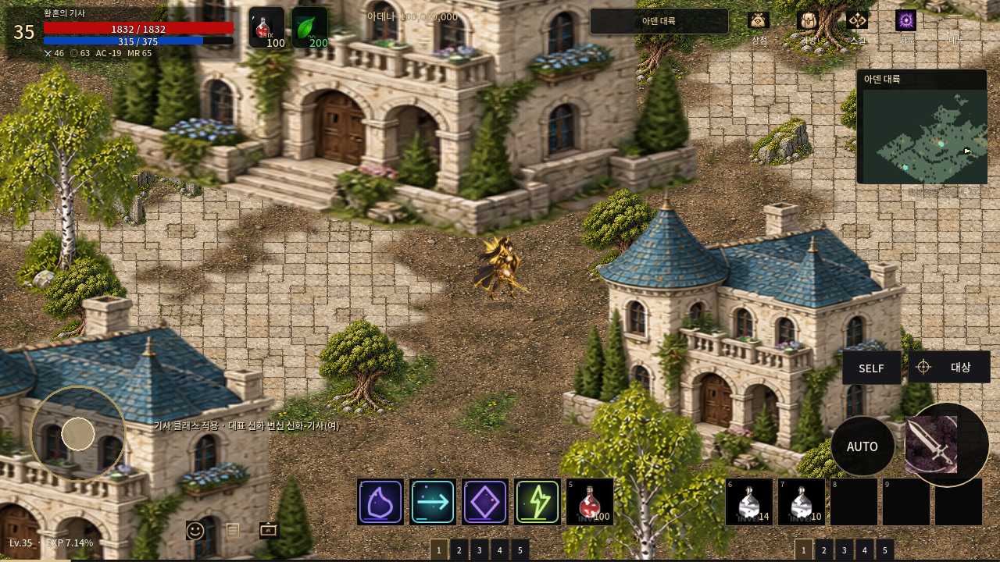
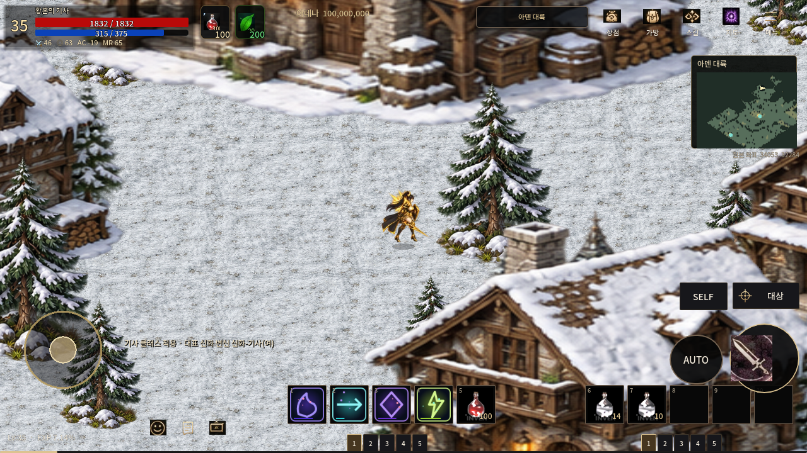
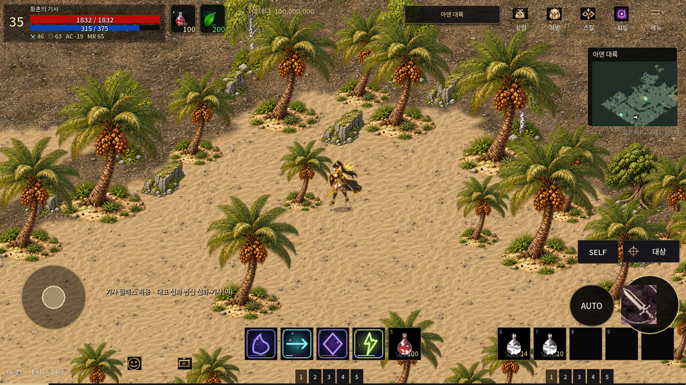
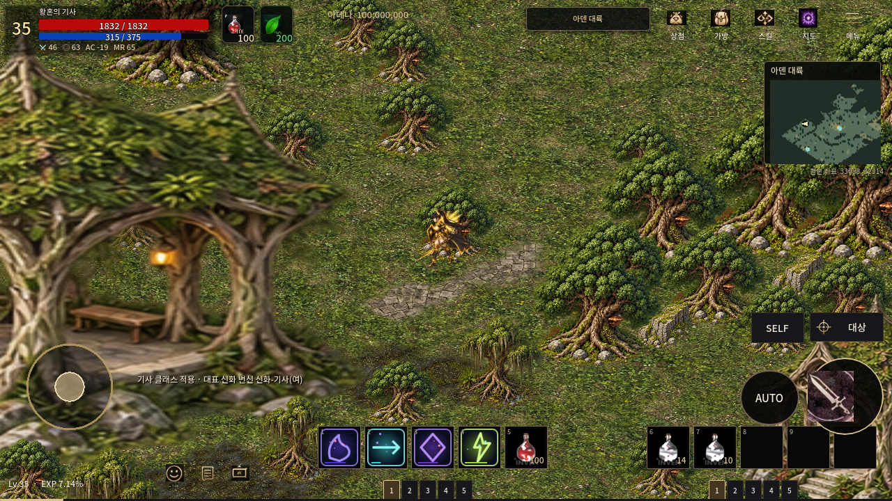

# 원작과 실제 Godot 화면

**기란 첫 검수는 승인 완료. 전역 최종 고증은 FAIL/미검증이다.** 아래 게임
이미지는 실제 Godot 캡처다. 원작 이미지는 출처 서버에 있는 공개 참고 자료다.
같은 패널 크기만으로 원작과 카메라가 동일하다고 판정하지 않는다.
[나란히 비교하는 HTML](comparison.html)과 [전체 실제 PNG 목록](SCREENSHOTS.md)도 제공한다.

| 승인 기란의 이전 실제 화면 | 경계 보완 후 실제 화면 |
|---|---|
|  |  |

이 두 TWILIGHT 화면은 셀 (983,828), 1280×720, zoom .85, 카메라 offset
(0,-32)로 같다. 임의 돌벽 제거, 부드러운 재질 전이, 아틀라스 반복 경계 보완을
직접 비교할 수 있다. 승인된 건물·장식·충돌 격자는 보존했다.

| 실제 리니지M 기란, 2017 | 신규 Godot 기란 |
|---|---|
|  |  |

[원문](https://www.inven.co.kr/board/lineagem/5056/392). 기념주·화단·포장과
건물 크기/방향은 다르다. 원작의 정확한 카메라 교정은 **NOT_RUN**이다.

| 실제 M 하이네 동쪽 필드, 2017 | Godot 하이네 늪지 해석 |
|---|---|
|  |  |

[원문](https://www.inven.co.kr/webzine/news/?news=180808&site=lineagem).
수목, 이끼/풀과 흙의 연결, 습한 지형 질감을 참고했다. 동일 위치·같은 나무
종·정확한 카메라를 검증한 비교는 아니다. 원작의 밀집 수목과 독자 모델의
실루엣·밀도·색 차이가 남는다.

| 실제 M 본토 지도, 2017년 갱신 이미지 | Godot 전역 실제 렌더 |
|---|---|
|  |  |

[원문](https://www.inven.co.kr/webzine/news/?news=182373&site=lineagem).
원작 자료는 지도 투영이고 오른쪽은 A3 소스의 게임 투영이다. 같은 카메라
비교가 아니다. 오른쪽은 QA에서 실제 3,072 시각 청크를 모두 그린 결과로,
평상시 플레이 성능이나 최신 M 지형 동일성의 통과 증거가 아니다.

| Godot 하이네 | Godot 오렌 |
|---|---|
|  |  |

| Godot 사막 | Godot 숲 |
|---|---|
|  |  |

지역별 바닥과 구조물 스타일은 독자 제작이다. 모든 마을의 실제 M 플레이
화면과 건물 단위 정합을 확보하지 못했으므로 그 항목은 NOT_RUN이다.
성 두 곳의 상세 화면은 원본 이동 가능 외곽에 선 플레이어와 QA 카메라로
찍었다. 막힌 내성을 걸어 들어갔다고 주장하지 않는다.

다른 건물·문 상태, 원본 TIL 미확보, S32 입구 3곳의 접근 실패, 기존 회귀
실패와 Android 미실행은 [차이 기록](REFERENCES_AND_DIFFERENCES.md) 및
[판정표](VALIDATION.json)에 그대로 남긴다.
