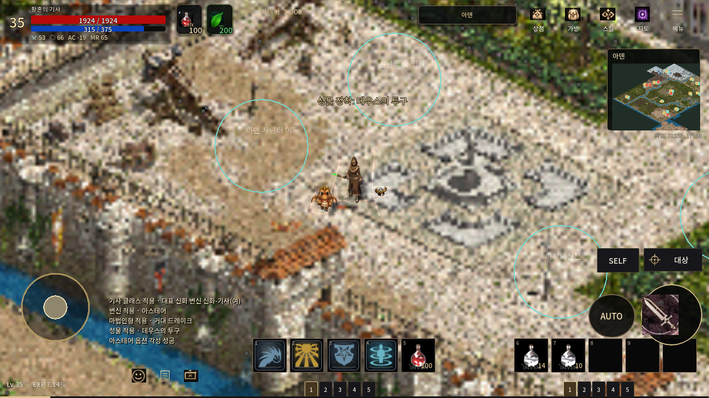
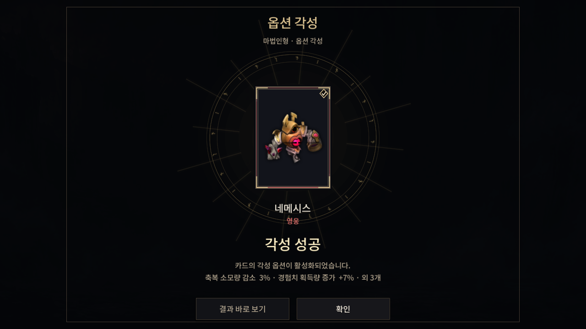
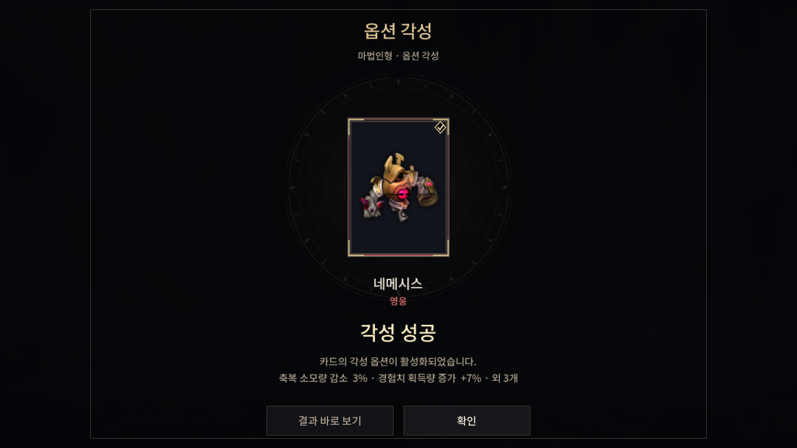

# PR152 전용 연출 후속 개선 — 2026-10-25

기준: main `cba19558de2764839feb4887a8af8f69b905257a`, PR152 `96a13abef18fc92e4a9212236b0adfdef2fa8bbb`. 초기 미커밋 변경 없음. 독립 worktree 사용. AGENTS.md·프로젝트 규칙·무결성 정책 확인 및 사전/사후 723시트·41,442프레임 SHA 검사 통과. 해당 checkout/main에 `.agents/skills`는 없었으며 다른 스킬 파일은 읽지 않았다.

캐릭터 전체를 둘러싸던 폐곡선 대신 양측 상승선과 발 주변 반원을 사용한다. 성물은 짧은 수평 궤도로 구분한다. 각성 결과의 문양은 카드로 모인 뒤 낮아지고, 성공 방사선은 잦아들어 이름/옵션 읽기를 방해하지 않는다. 시각 형태·명암·연출 시간만 수정했으며 확률·재화·능력치·저장 트랜잭션을 바꾸지 않았다. 기존 정상 자산을 유지했으며 신규/편집 PNG 원화는 없다. 아래 PNG는 Godot 실행 화면 캡처다.

공통 world/HUD/theme, PR122 개체·공격 마커·방향 프로필, PR154·155 자산은 수정하지 않았다. 최신 main을 확인했으나 기존 PR의 이력을 변경하거나 main을 병합하지 않았다.

## 실제 자료와 해석 범위

- [리니지M 2021-12-08 실제 스킬 각성 화면](https://www.inven.co.kr/board/lineagem/5056/19586): 어두운 판 위에 카드와 재료 슬롯, 절제된 금속 테두리, 낮은 대비의 원형 문양을 확인했다. 이는 **스킬 각성** 화면이며 옵션 각성 규칙/확률의 출처로 사용하지 않았다.
- [NC 2021-12 각성 개편 안내](https://lineagem.plaync.com/board/cm_story/view?articleId=61af4021ef52766eecc85496): 동적 본문은 현 환경에서 이미지까지 회수되지 않았다.
- [NC 2025-04-30 패치](https://lineagem.plaync.com/board/update/view?articleId=50526050)는 카드 UI 각성 효과 개선을 명시한다. 따라서 2021 화면을 현행 효과와 동일하다고 주장하지 않는다.

같은 리니지M 계열의 자료로 비교했으며 리니지W/2M/PC 효과를 혼합하지 않았다. 필드 연출과 정확한 프레임 타이밍은 TWILIGHT의 자체 표현이다. 최신 옵션 각성 전체 영상과 일대일 고증 승인은 미완료이며 유사도 점수는 산정하지 않았다.

## 같은 조건 전후

실제 Main, 1280×720, 동일한 세 카드·장소·seed·연출 시각으로 캡처. UI는 같은 카드 및 settled 시각.

|필드 전|필드 후|
|---|---|
|||

|결과 전|결과 후|
|---|---|
|||

## 국소 실행 검사

Godot **4.7.2**, Linux Xvfb/Mesa llvmpipe Compatibility. Android 실기기 결과가 아니다.

- 전용 VFX 39/39, Main 필드 65/65(전후 모두), 서비스 133/133, UI 103/103, 저장/월드 138/138.
- aura는 전후 3노드. 낮은 상세도·reduced motion·숨김·해제·타깃 소멸·이동·발 정렬 검사 통과. 추가 노드/텍스처를 만들지 않는다.
- 필드 120프레임 관측: 중앙값 45.694→23.621ms, p95 193.926→36.457ms. **다른 국소 실행과 CPU 경쟁이 있어 성능 향상 근거로 사용할 수 없다.** 환경·원시 수치는 JSON에 보존했다.
- 초기 미수입 리소스로 실패한 실행을 통과로 집계하지 않았다. import 복구 후 위 결과를 확보했다. UI 테스트는 명시적 격리 플래그를 추가한 재실행 결과다.
- 전체 CI 실행/취소 없음. Windows·Android·장시간 사냥 및 최신 원작 전체 비교는 미검증.

재현: `tests/option_awakening_vfx_test.gd`, `tests/option_awakening_field_render_test.gd`를 별도 `XDG_DATA_HOME`에서 실행. 필드 이전 버전은 `git show 96a13abe:scripts/animation/option_awakening_aura.gd > tests/_baseline_aura.gd` 후 `TWILIGHT_AURA_BASELINE=1`로 실행한다. UI 검사에는 `TWILIGHT_UI_TEST_ISOLATED=1`이 필요하다. 캡처 인자는 기존 테스트의 `--option-field-capture` / `--option-vfx-capture` 사용.

`local-checks.zip`에 상세 로그, `sha256.json`에 실제 전달 파일 바이트·SHA를 기록했다. Library 업로드 준비 후 PUT 전송은 네트워크 터널 `403 Forbidden`으로 거절되어 finalize하지 않았다. 확인된 library_file_id 없음. 원본 외부 리소스 장부의 미전달 상태는 그대로다.
