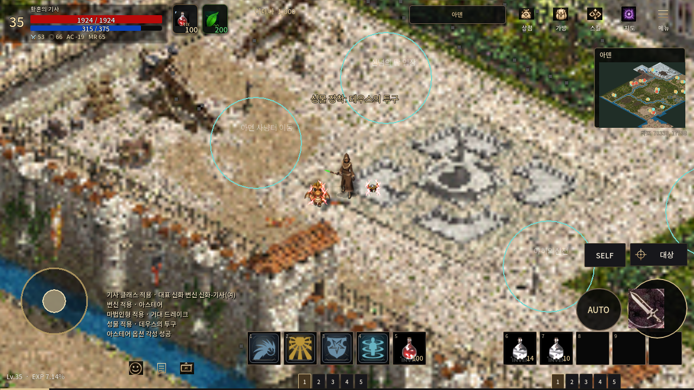

# PR152 — 몸에 붙는 각성 번개로 교정

작업 기준: main `cba19558de2764839feb4887a8af8f69b905257a`, PR152 `afa9053585edf088e22d97ffa46ff8eb37e66289`. 이전 타원·상승선 표현이 리니지M의 각성 전기를 놓쳤다는 사용자 피드백을 반영했다. 독립 worktree에서 기존 커밋을 보존하고 후속 커밋으로 수정했다. 초기 미커밋 변경 없음, AGENTS/프로젝트 규칙/리소스 정책 재확인, 사전·사후 723시트/41,442프레임 무결성 통과. `.agents/skills` 없음.

## 표현 교정

- 실제 **8프레임 PNG**를 ImageGen으로 신규 제작했다. 몸 주변에 붙는 불규칙한 분기, 흰 중심선, 붉은 가장자리, 짧은 재방전과 끊긴 잔류 전기를 사용한다. 타원 궤도·상승 리본·떠오르는 점 입자는 없앴다.
- 영웅은 붉은 전기, 전설은 보라 전기. 다른 등급은 프로젝트의 기존 색상 정책을 유지하며 원작 색상표를 확정했다고 주장하지 않는다. 세 부착물의 시각 위상을 나눠 동시에 모두 섬광을 내지 않는다. `reduced_motion`에서는 깜박임 없는 정지 프레임을 보여 준다.
- 변신/인형/성물 각자의 기존 시각 중심과 발 정렬을 계속 따른다. 캐릭터/방향/공격 마커/프로필을 수정하지 않는다. 카드 테두리에도 같은 번개 프레임을 쓰고 기존 상태 배지와 입력을 유지했다.
- 게임 확률·재료·능력치·피해·사거리·쿨타임·저장 로직 변경 없음. 공통 HUD·world·theme 및 PR122·154·155 파일 변경 없음.

## 실제 리니지M 자료

- [2020-11 실제 진 데스나이트 각성 화면](https://www.inven.co.kr/board/lineagem/5019/271692): 몸 가까이에 붙는 붉은 전기 픽셀을 직접 확인했다.
- [2021-06 몸의 번개를 설명하는 당시 플레이어 글](https://www.inven.co.kr/board/lineagem/5019/334239): 영웅의 빨간 전기와 전설의 보라 전기를 구분한다.
- [2023-07 인형 각성의 빨간 번개 보고](https://www.inven.co.kr/board/lineagem/5019/511030): 장착·소환 개체의 각성 전기와 공격 스킬을 구분했다.
- [2024-01 리니지M 실제 전투 번개 화면](https://www.inven.co.kr/board/lineagem/5019/554743): 내려치는 전투 번개와 몸의 부착 전기를 혼동하지 않도록 비교했다.

리니지M 자료만 사용했다. 원작 이미지를 공개 저장소에 복사하지 않았으며 새 PNG는 자체 제작이다. 같은 게시물에 있던 반응 GIF는 실제 게임 영상이 아니므로 근거에서 제외했다. 정확한 원작 루프 길이/프레임 배열과 2026 버전 전체 고증은 미확인이다. 새 0.66초 시각 루프는 자체 연출값이며 원작 수치나 게임 재사용 대기시간이 아니다. 유사도 점수는 산정하지 않는다.

## 실제 실행 화면·영상

[약 3초 실제 Main 각성 표시/이동 영상](field-lightning.mp4): 178프레임, 60fps 고정 시뮬레이션의 Godot Movie Maker 기록. 2.9667초의 게임 진행을 Linux 소프트웨어 렌더러에서 약 46초에 생성했다. 실시간 60fps 성능 주장이 아니다. 전투 영상으로 표시하지 않는다.

|같은 Main 조건의 이전 표현|새 번개 표현|
|---|---|
|||

순간 캡처에서 변신의 전기가 끊겨 있는 것은 방전 사이 구간이다. 전체 프레임 교대는 영상으로 확인한다. `result-after.png`에는 실제 카드의 흰 중심선/붉은 가지 표현을 보존했다.

## 국소 검증과 자원

- Godot **4.7.2**, Linux Xvfb/Mesa llvmpipe Compatibility. 전용 VFX **39/39**, Main 실제 부착·이동·표시 설정·해제 **65/65** 통과. 두 영상 디코드/프레임 수 확인. Android 실기기는 미검증.
- 필드 효과는 전후 **3노드**, 노드별 자식 0. 카드 상태 테두리는 전용 표시용 Control 1개를 추가하며 입력을 받지 않는다. 각성 해제 시 처리/표시를 중단하고 대상 소멸 시 고아 효과를 숨긴다.
- 새 PNG는 1774×887 RGBA, 디코드 **6,294,152바이트**의 공유 정적 자산이다. 8개 프레임은 파일 분할/수정 없이 원본 PNG의 영역을 읽는다. 해제마다 이 공유 preload를 버린다는 주장은 하지 않는다. 동적 sprite/texture를 계속 추가하지 않는다. 실제 바이트·SHA는 `data/cards/option_lightning_art.json`에 기록했다.
- 초기 일반 렌더 비교 120프레임 중앙값 19.038→17.807ms, p95 31.851→27.202ms. 이후 실제 픽셀 확인 후 표시 범위를 더 밀착시켰으며 최종 실행은 Movie Maker 캡처다. 초기 일반 렌더 수치를 최종 성능 향상 근거로 사용하지 않는다. 최종 캡처의 원시 측정은 `field-after.json`에 있다.
- 전체 CI 실행/취소 없음. 긴 사냥, Windows/Android, 최신 원작 타이밍 전체 대조는 미검증.

재현: `tests/option_awakening_field_render_test.gd` + 별도 `XDG_DATA_HOME` + `--option-field-capture=<폴더>`. `--fixed-fps 60 --write-movie <영상.avi>`로 기록할 수 있다. 이전 표현은 기준 SHA의 aura 스크립트를 `tests/_baseline_aura.gd`로 꺼내 `TWILIGHT_AURA_BASELINE=1`로 실행한다. `local-checks.zip`은 로그, `sha256.json`은 전달된 비교 파일의 실제 SHA다.

Library 전송은 앞선 동일 환경의 네트워크 터널 403 거절 상태를 유지하며 우회/재시도하지 않았다. 확인된 library_file_id 없음. PR에 추적된 자산·증거로 전달한다.
