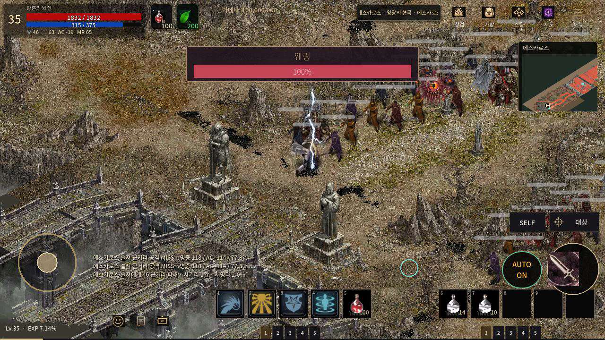
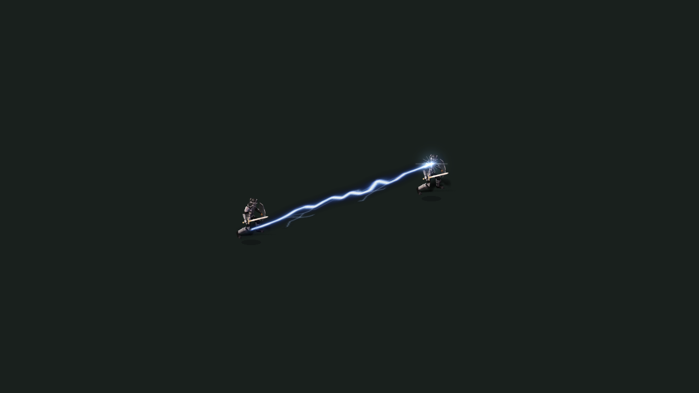
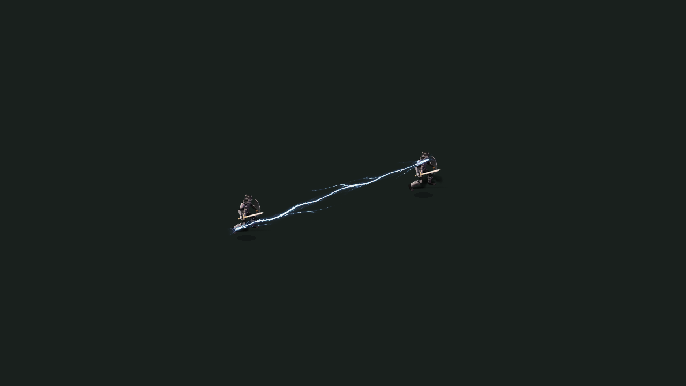

# PR153 — 실제 전투에 분기 번개 프레임 연결

기준: main `cba19558de2764839feb4887a8af8f69b905257a`, PR153 `0e730412e1a9688086acef3874c5abbaedac7b12`. 독립 worktree·기존 커밋 보존. 초기 미커밋 변경 없음. AGENTS·프로젝트 규칙·무결성 정책 재확인, 사전/사후 723시트/41,442프레임 SHA 일치. `.agents/skills` 없음.

## 실제 형태를 바꾼 부분

기존 70개 아틀라스와 정상인 비번개 스킬은 보존했다. **새 ImageGen PNG 16프레임**을 제작하고 썬더 볼트·라이트닝 스트라이크·썬더 스턴·체인 라이트닝 및 이 시각 자산의 상속 경로에 연결했다.

낙뢰 8프레임은 불규칙한 세로 줄기와 갈라지는 가는 가지를 갖는다. 연쇄 8프레임은 수평 전기 통로와 달라지는 분기 형태를 갖는다. 타격을 원형 발광/범용 별 모양으로 덮는 flare는 이 네 계열에서 제외한다. 넓은 파란 가장자리는 재생 셰이더에서 눌러 흰 중심선과 분기가 읽히도록 한다. PNG는 도구 생성 결과를 그대로 복사했으며 외부 원작 픽셀이나 Python으로 그린 래스터를 사용하지 않았다.

실제 생성 PNG의 각 프레임에서 낙뢰 끝과 연쇄 양 끝의 픽셀 위치를 확인해 앵커를 기록했다. frame_changed 시점에도 위치를 갱신하여 애니메이션이 다음 프레임으로 넘어가며 발/타깃에서 한 프레임 밀리지 않도록 했다. 기존 3개 레이어와 풀을 재사용한다. 풀 재사용 시 offset과 shader를 초기화하여 다른 스킬에 전기 표현이 남지 않는다.

피해·사거리·쿨타임·발동 확률·능력치·재화 변경 없음. 공통 world/HUD/theme, PR122 개체·공격 마커·방향/별칭, PR154·155 자산 변경 없음.

## 리니지M 참고와 한계

[2024-01 실제 리니지M 번개 3종 전투 화면](https://www.inven.co.kr/board/lineagem/5019/554743)의 픽셀에서 가늘고 긴 낙뢰 줄기, 타깃에 모이는 밝은 핵, 주변의 갈라지는 가지를 확인했다. 몸에 붙는 각성 전기는 [2020 실제 각성 화면](https://www.inven.co.kr/board/lineagem/5019/271692), [2021 몸의 전기 구분](https://www.inven.co.kr/board/lineagem/5019/334239)과 구분해서 다뤘다. 다른 게임의 효과를 혼합하지 않았다.

여기서 검증한 것은 같은 리니지M 계열의 형태/방향/접점/명암이다. 정확한 원작 8프레임 배열·총 지속 시간·2026 전체 버전별 변화는 미확인이다. 신규 프레임의 밀리초와 표시 크기는 자체 시각 값이다. 원작 수치나 유사도 점수로 표시하지 않는다. 70개 전체의 원작 고증이 완료됐다는 의미도 아니다.

## 실제 실행

[6.0167초 Main 전투 영상](combat.mp4): 361프레임/60fps 고정 시뮬레이션을 실제 Godot Movie Maker로 기록했다. 녹화에 약 68초의 Linux 소프트웨어 렌더 시간이 걸렸다. 실시간 60fps 성능 주장이 아니다. 기존 Main 개체와 근접 공격 마커 → on_hit → 원래 발동 확률 → 실제 damage/VFX 경로를 사용했다. RNG를 강제로 성공시키거나 발동 확률/타깃 HP를 바꾸거나 VFX를 직접 emit하지 않았다. 격리된 테스트 저장에서 뇌신과 두 패시브를 준비했고, 다른 몬스터 AI는 정지한 국소 전투 fixture다.

실제 **연쇄 3회 + 낙뢰 1회**를 관측했다. 6개 확인 조건 통과: 일반 진입, 실제 맵, 기존 유효 타깃, 원래 확률에 의한 발동, 맵 전환 후 VFX/flight 정리, 새/기존 atlas pin 회수. `combat.json`에 이벤트와 프레임을 보존했다.

|동일 개체·위치·시각의 연쇄 이전|연쇄 이후|
|---|---|
|||

전후 표는 Main 제공 Player 개체 둘을 쓰는 결정적 연출 fixture이며 피해 판정을 만들지 않는다. 실제 전투 검증과 구별한다.

## 국소 검사·자원·성능

Godot **4.7.2**, Linux Xvfb/Mesa llvmpipe Compatibility. Android 실기기 미검증.

- authored VFX **1,648/1,648** 통과. 새 8프레임의 접점을 8방향과 1.4배 시각 배율에서도 검사한다. 프레임 교체 신호 후 명시적인 수동 pose 보정 없이 접점이 유지된다. 풀 제한/실제 도착 callback/취소·상태 수명/atlas 회수 검사도 유지했다.
- 기존 70개 실제 PNG/6,720셀/42,471,360바이트는 `verify_authored_vfx.py --require-tracked` 통과. 새 PNG는 1254×1254 RGBA, 디코드 **6,290,064바이트**, 16영역. `data/skills/lightning_art.json`에 파일 SHA·실측 앵커·프레임 시간을 기록했다.
- 새 PNG도 기존 48MiB atlas 예산에 포함한다. 별도 무제한 preload/cache를 추가하지 않는다. 전투 peak live VFX **1개**, atlas peak **12,581,520바이트**. 맵 전환 후 live/flight/atlas bytes 0을 확인했다. SpriteFrames 참조를 풀에서 해제하는 검사도 통과했다.
- 결정적 연출 fixture의 VFX 루트 직계 자식은 전후 2개(오디오 루트 포함, 전체 하위 노드 수가 아님). 120프레임 중앙값 16.667→16.664ms, p95 19.806→21.332ms. 최종 전투 녹화 중앙값 66.612ms, p95 108.009ms. 공유 CPU/소프트웨어 렌더 및 녹화 비용이 있어 성능 개선이나 기기 FPS로 일반화하지 않는다.
- MP4 전체 디코드 오류 없음. 전체 CI 실행/취소 없음. Windows/Android·장시간 사냥·전체 스킬의 동시대 원작 영상 대조는 미검증.

재현: 별도 `XDG_DATA_HOME`에서 `tests/authored_skill_vfx_test.gd`. 전투는 `TWILIGHT_LIGHTNING_COMBAT_DIR=<폴더>`와 `tests/capture_lightning_combat.gd`, `--fixed-fps 60 --write-movie <영상.avi>` 사용. 기존 연출 fixture는 `tests/capture_vfx_continuity.gd`이다. 이전 화면은 기준 SHA의 skill_vfx.gd를 class_name 줄을 뺀 `tests/_vfx_before.gd`로 만들어 `TWILIGHT_CONTINUITY_BASELINE=1`로 캡처했다. 상세 로그는 `local-checks.zip`, 비교 파일 실제 SHA는 `sha256.json`.

Library는 앞선 동일 환경 PUT의 네트워크 터널 403 거절을 우회/재시도하지 않았다. 확인된 library_file_id 없음. 신규 바이너리와 증거를 기존 PR 브랜치에 추적해 전달한다.
