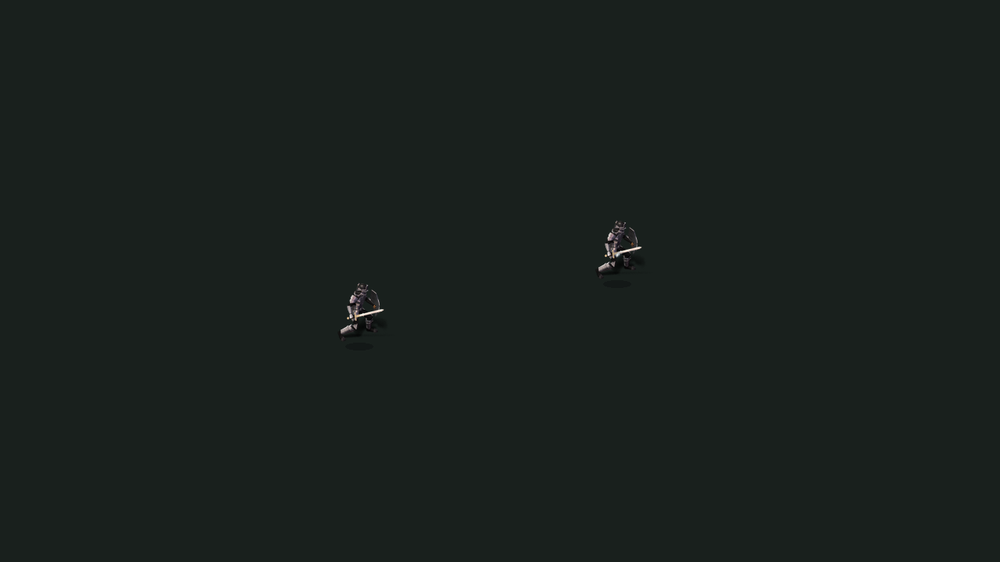

# PR153 VFX 착지·전투 연결 후속 — 2026-10-25

기준 main `cba19558de2764839feb4887a8af8f69b905257a`, PR153 `504f96b3b5b65a6fd7711dbb6187a25af36b5a78`. 독립 worktree, 초기 미커밋 변경 없음. AGENTS/프로젝트 규칙/무결성 정책 확인. `.agents/skills` 없음. 기존 커밋을 보존하고 main 재병합이나 공통 world/HUD/theme 재작성 없이 전용 모듈만 수정했다.

## 변경

- 기존 70개 PNG 아틀라스는 보존한다. 타격 후 프레임의 실제 도형이 바닥 먼지/잔광인 것을 확인하고, 몸통 타격점이 아니라 제공된 `ground_point`에 그려진 입자 원점을 맞춘다. 128px 셀의 (64,90)/(64,91)/(64,85)는 기존 제작기의 실제 좌표이며 원작 수치가 아니다. 방향성 칼날·화살의 각도를 바닥 입자에 적용하지 않는다.
- 크기가 다른 이펙트에서도 번개의 착지점과 연쇄 번개의 양 끝점이 어긋나지 않도록 월드 좌표를 컨테이너 로컬 좌표로 변환한다.
- 이동/지속 효과의 관측 위치가 갱신될 때 기존 SPX sprite 경로도 같은 위치를 따른다. 외부 비공개 SPX 팩 자체의 시각 고증은 이번에 확인하지 않았다.
- 추가 검사: 8방향 지면 정착 및 1.4배 시각 컨테이너에서도 연쇄 양 끝점 유지. 값은 검사용 시각 배율이며 게임 규칙 변경이 아니다.

피해·사거리·쿨타임·확률·능력치·재화, PR122 캐릭터/방향/공격 마커, PR154·155 자산은 변경 없음. 새 원화 PNG를 제작하거나 편집하지 않았다. 아래 PNG는 실제 Godot 캡처다. 70개 전체를 다시 그렸다는 의미가 아니다.

## 실제 리니지M 자료

[2021-06-16 리니지M 일반 디스인티그레이트 실행 GIF](https://www.inven.co.kr/board/lineagem/5064/37498)의 실제 픽셀을 확인했다. 좁은 사선 광선이 대상에 모이며, 밝은 핵과 낮은 바닥 잔광이 분리된다. 고른 원형 발광으로 뭉치지 않도록 **타격점과 바닥 잔광의 역할 분리**를 이번 연결 수정에 반영했다. 이 자료는 일반 디스이며 에이션트/다른 게임/현재 리뉴얼판과 동일하다고 간주하지 않았다. 그림을 공개 저장소에 복사하지 않았다.

자료 한 건으로 70개 효과의 원작 일치도나 정밀 타이밍을 증명할 수 없다. 전체 동시대 스킬별 영상 대조와 최신 리니지M 고증 승인은 미완료다. 재현 시간과 색/형태는 기존 TWILIGHT 자산의 자체 값이며 유사도 수치를 만들지 않았다.

## 전후 및 실제 전투

동일한 Main 제공 Player 개체 두 개, 동일 좌표·이펙트·잔상 시각(.08초), 1280×720의 결정적 연출 fixture. 이 fixture는 피해 판정을 만들지 않는다.

|잔상 전|잔상 후|
|---|---|
|||

[5초 실제 Main 전투 영상](live-combat.mp4), [실제 자동 슬롯 타격 화면](controlled-auto-contact.png), [전투 중 화면](live-field.png).

영상은 실제 실행 화면 기록이며 연출 fixture를 전투라고 표시하지 않았다. 100프레임/5초 MP4를 전체 디코드 검사했다. 캡처 종료 시 X11 메시지는 로그에 남겼으나 영상 전체 디코드 오류는 없다. 900프레임 실행은 180초 제한에서 종료되어 통과로 계산하지 않았다. 이 실행에서 실제 투사체 3회 타격과 영상만 확보했다.

별도 `TWILIGHT_VFX_MAIN_FRAMES=180` 실행은 완료: 실제 자동 슬롯 타격 1회, 자동사냥 타격 25회, peak live VFX 4개, atlas 6,291,456바이트. 실제 맵 전환 후 VFX/flight가 비는 검사 통과. `main-runtime.json` 참조. 기본 테스트는 여전히 900프레임이며, 짧은 국소 검사에만 환경 변수를 사용한다.

## 국소 검사 및 수명

Godot **4.7.2**, Linux llvmpipe Compatibility. Android 실기기와 구별한다.

- authored VFX 1,574/1,574 통과. 8방향·풀 제한·실제 도착 callback·취소·재생 세대·status 타깃 소멸·atlas pin 회수 포함.
- `verify_authored_vfx.py --require-tracked`: 70개 실제 추적 아틀라스, 6,720셀, 42,471,360바이트, 125프로필, 상속10 통과.
- 사전/사후 공개 리소스 무결성: 723시트·41,442프레임·SHA 일치. 외부 원본 전체 전달 완료를 뜻하지 않는다.
- 연출 fixture의 VFX 루트 직계 자식은 전후 2개(오디오 루트 포함; 전체 하위 노드 수가 아님). clear 후 live 0, atlas bytes 0. 풀 sprite의 frame 참조 해제도 검사했다.
- 동일 120프레임 fixture 중앙값 16.639→16.661ms, p95 20.901→17.704ms. Main 짧은 실행은 중앙값 215.909ms, p95 403.086ms. 소프트웨어 렌더러/공유 CPU 결과이므로 성능 개선이나 실기기 FPS로 일반화할 수 없다. 전후 실행 중 다른 국소 작업의 CPU 경쟁도 있었다.

재현: 별도 `XDG_DATA_HOME`, `tests/authored_skill_vfx_test.gd`; OpenGL로 `tests/capture_vfx_continuity.gd` + `TWILIGHT_CONTINUITY_DIR`. 이전 화면은 `git show 504f96b3:scripts/skills/skill_vfx.gd | sed '/^class_name TwilightOriginalSkillVFX$/d' > tests/_vfx_before.gd` 후 `TWILIGHT_CONTINUITY_BASELINE=1`로 실행한다. Main은 `tests/capture_skill_vfx_main.gd`, `TWILIGHT_VFX_MAIN_FRAMES=180`, `TWILIGHT_VFX_MAIN_DIR` 사용.

전체 CI 실행/취소 없음. Windows·Android·장시간 전투·전체 70개 원작 영상 대조 미검증. 상세 로그는 `local-checks.zip`, 실제 파일 SHA는 `sha256.json`. Library PUT은 네트워크 터널 `403 Forbidden`으로 거절되어 우회하거나 finalize하지 않았다. 확인된 library_file_id 없음.
