# 화면 비교

기존 main을 실제 실행한 변경 전 화면과 이번 브랜치의 OpenGL 캡처다. 변경 후는 장비 표시를 검증하려고 기존 DB의 장비 10개를 장착한 별도 저장 상태다. HP/MP·능력치·아이템 수량·월드 객체 위치는 시각 동일성 비교 대상에서 제외한다.

공식 참조는 원격 원문 링크로 표시하며 이미지 파일을 저장소에 재배포하지 않았다. 각 연도와 출처는 [참조 기록](REFERENCES.md)에 있다. 원작의 삭제 대상 기능·기본 게임 자산과 이번 구현의 차이를 포함한다. 전체 UI 1% 일치를 달성했다는 보고가 아니다.

[겹침 슬라이더 비교](comparison.html)를 로컬 브라우저에서 열면 두 화면을 같은 16:9 표시 영역에서 비교할 수 있다. 아래 표는 GitHub에서도 읽을 수 있다.

## HUD

| 변경 전 | 공식 참조 | 변경 후 |
| --- | --- | --- |
| 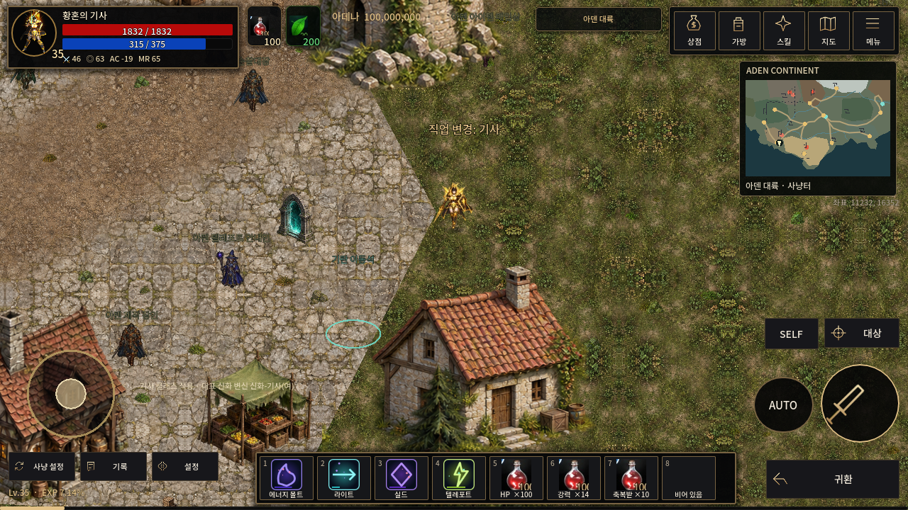 |  | 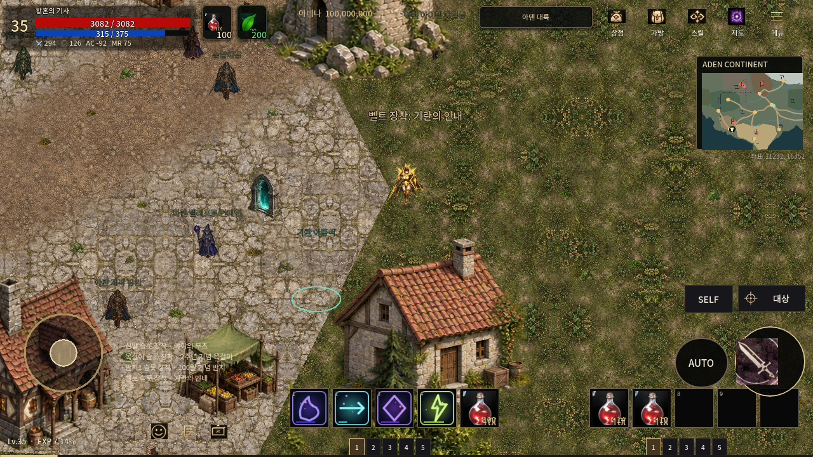 |

## 가방

| 변경 전 | 공식 참조 | 변경 후 |
| --- | --- | --- |
| 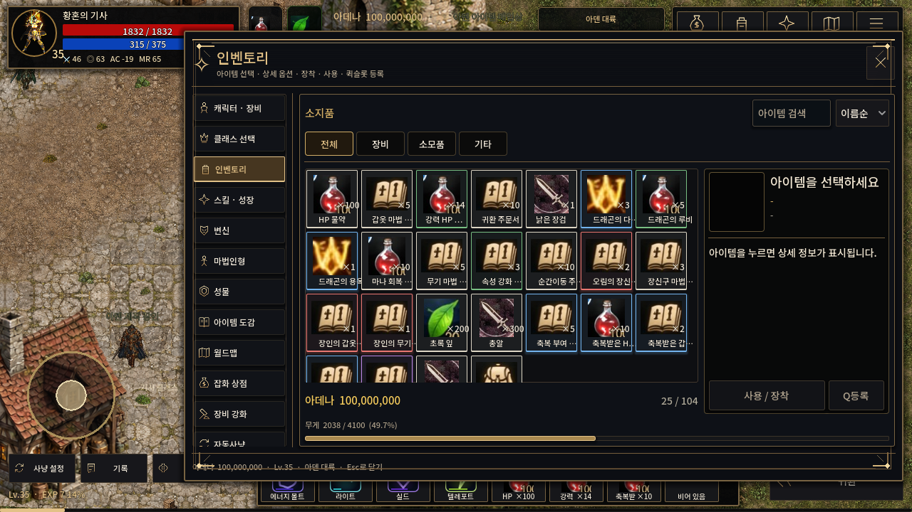 |  | 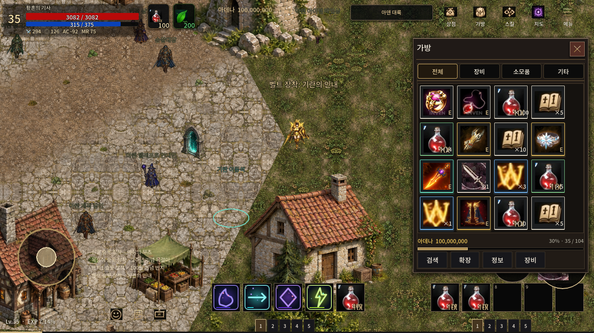 |

## 캐릭터

| 변경 전 | 공식 참조 | 변경 후 |
| --- | --- | --- |
| 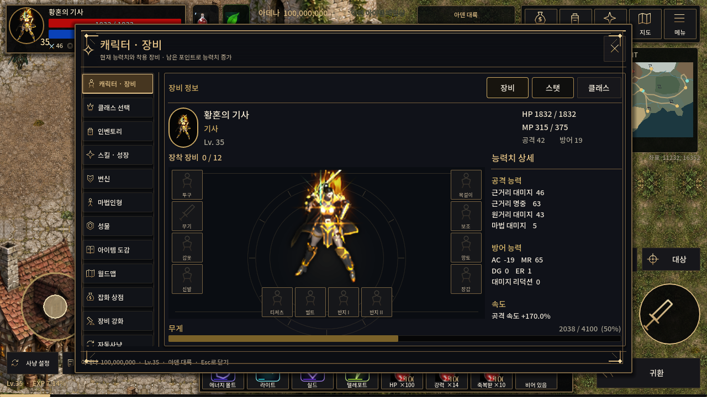 |  | 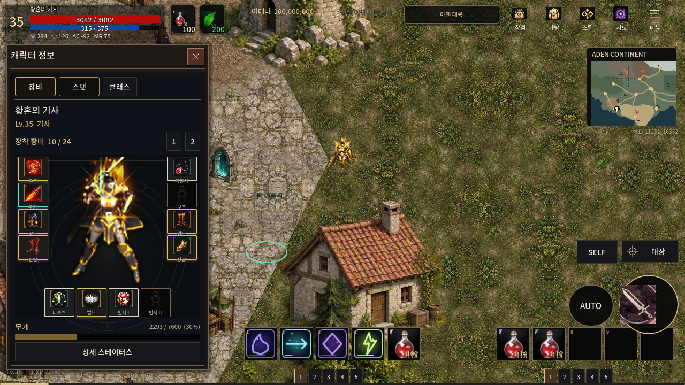 |

## 스킬

| 변경 전 | 공식 참조 | 변경 후 |
| --- | --- | --- |
| 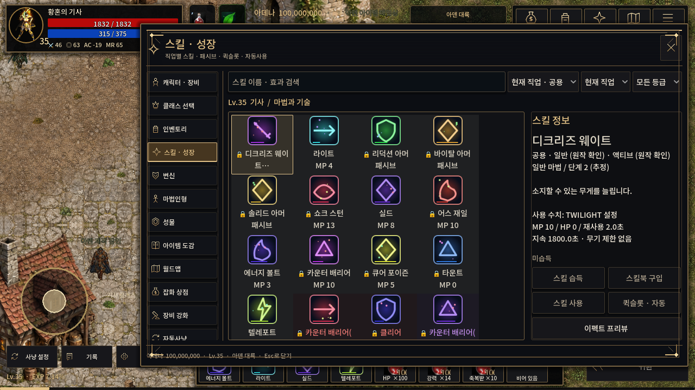 |  | 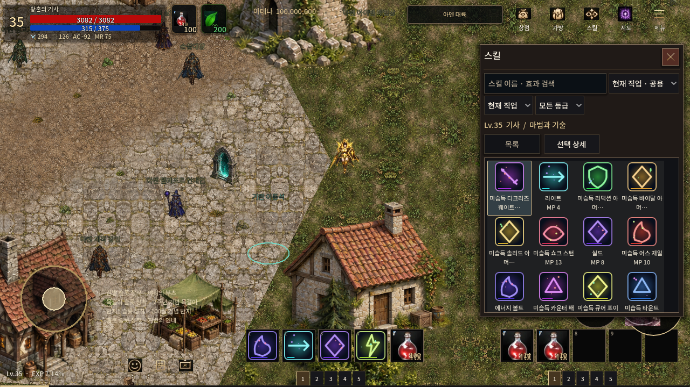 |

## 변신

| 변경 전 | 공식 참조 | 변경 후 |
| --- | --- | --- |
| 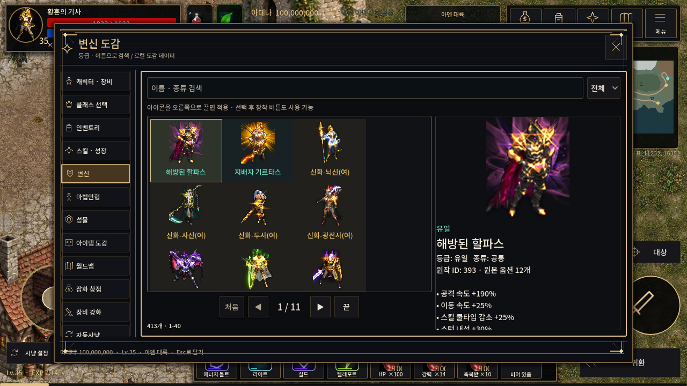 |  | 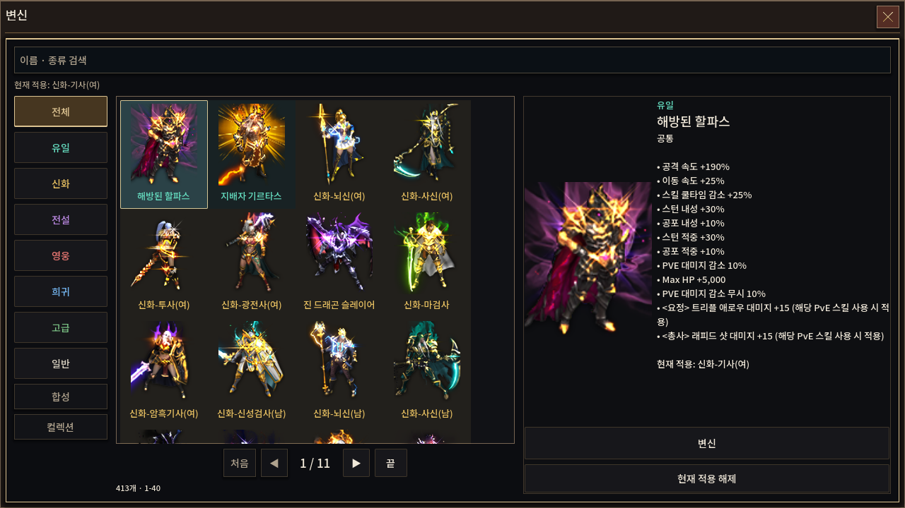 |

## 상점

| 변경 전 | 공식 참조 | 변경 후 |
| --- | --- | --- |
| 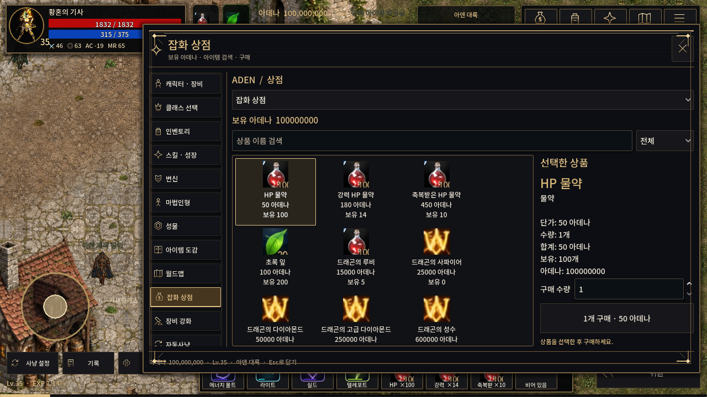 |  | 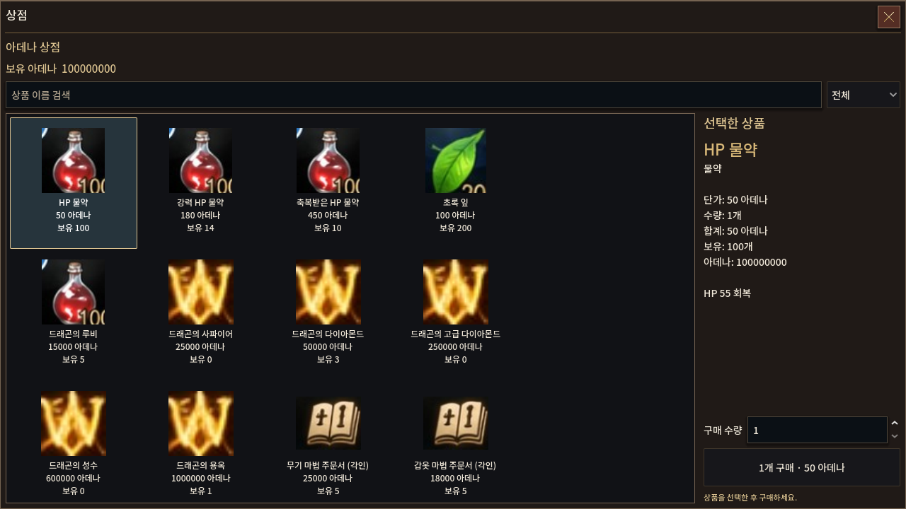 |

## 추가 화면

- [가방 상세](evidence/after/inventory-detail-1280x720.png)
- [가방 확장](evidence/after/inventory-expanded-1280x720.png)
- [장비 두 번째 페이지](evidence/after/character-equipment-2-1280x720.png)
- [기본 스탯](evidence/after/character-stats-1280x720.png)
- [상세 스탯](evidence/after/detailed-stats-1280x720.png)
- [스킬 상세](evidence/after/skill-detail-1280x720.png)
- [마법인형](evidence/after/catalog-detail-마법인형-1280x720.png)
- [성물](evidence/after/catalog-detail-성물-1280x720.png)
- [NPC 상점](evidence/after/npc-shop-1280x720.png)
- [구매 확인](evidence/after/purchase-confirm-1280x720.png)
- [창고](evidence/after/warehouse-1280x720.png)
- [판매](evidence/after/sell-1280x720.png)
- [제작](evidence/after/crafting-1280x720.png)
- [강화](evidence/after/forge-target-1280x720.png)
- [자동사냥](evidence/after/auto-1280x720.png)
- [설정](evidence/after/settings-1280x720.png)
- [메뉴](evidence/after/menu-1280x720.png)

[1920×1080 가방](evidence/after/inventory-1920x1080.png) · [2400×1080 요청 시 활성 화면](evidence/after/inventory-2400x1080.png). 후자는 1920×1080 게임 텍스처이며 기존 레터박스 정책을 유지한다.
