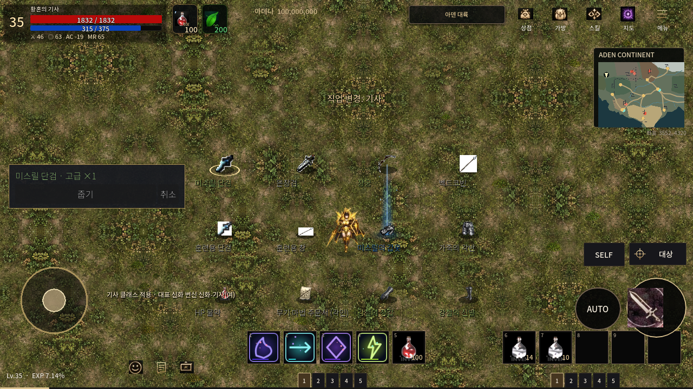
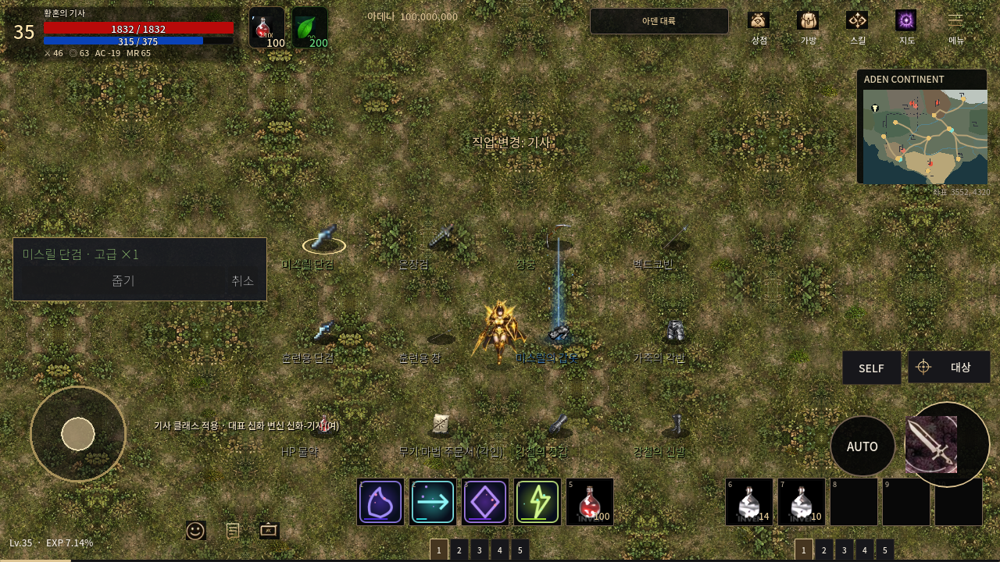
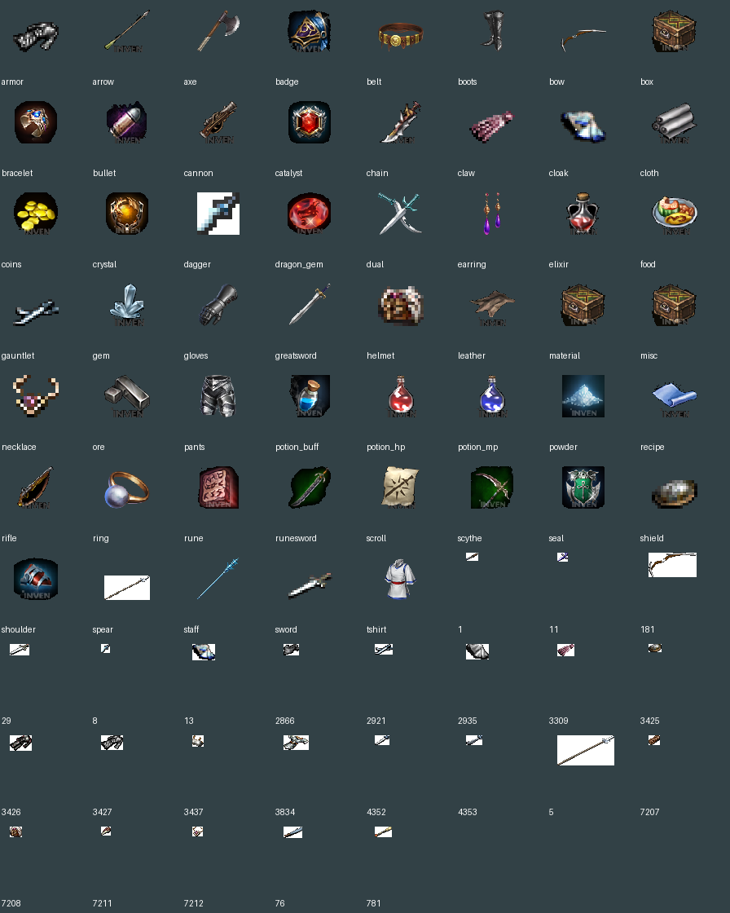
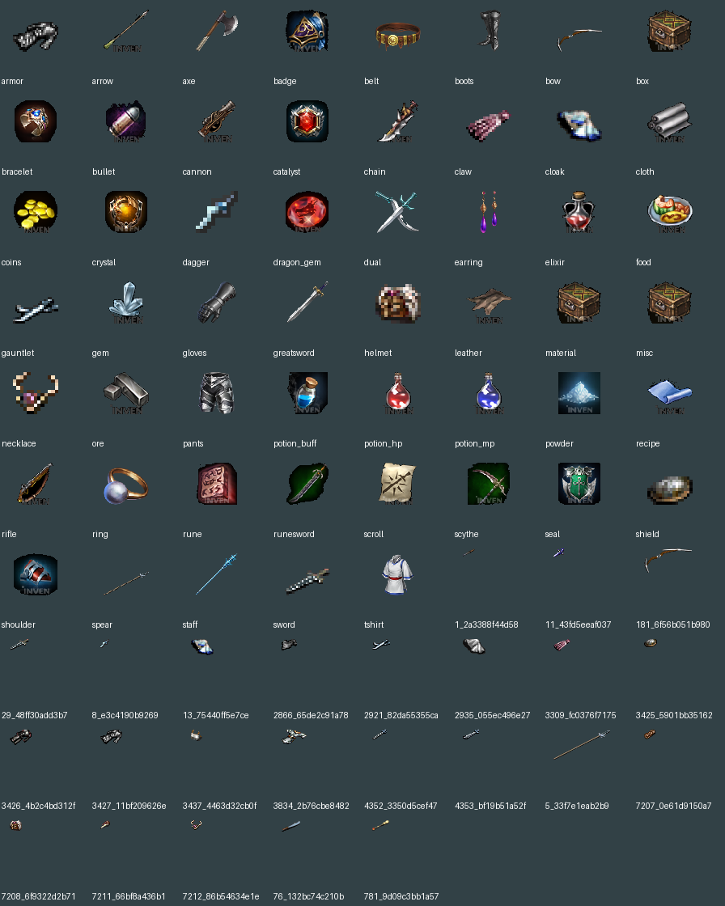

# 바닥 아이템 흰 배경 제거

기준 main: `91ae30fe0562fc3e652645f3d325ae650914ca4a`.

## 수정 원인

이전 배경 처리는 네 모서리 중 세 모서리가 흰색일 때만 흰색 제거를 켰다. 대각선 물체가 두 모서리를 차지한 단검·창에서는 이 조건이 성립하지 않아 흰 사각형이 남았다. 또한 기존 전용 바닥 이미지는 종류별 대표 이미지 처리 경로를 통과하지 않았다. 투명한 64×64 캔버스의 (0,0) 픽셀만 확인하면 내부의 흰 사각형을 발견하지 못했다.

## 변경

- 원본 이미지의 실제 테두리에서 흰 배경을 찾아 8방향으로 이어진 외부 영역의 alpha만 제거한다. 흰색 전체 삭제나 색상 대체를 하지 않는다. 내부에 둘러싸인 흰 광택은 보존한다.
- 대표 이미지 53분류를 같은 재현 도구로 다시 검사·생성한다. 바뀐 PNG 목록은 검증표의 `changed_category_pngs`에 기록한다. 정상 파일을 모두 바꿨다고 계산하지 않는다.
- 별도 바닥 전용 원본은 덮어쓰지 않고 같은 크기의 alpha-only 파생 PNG를 `assets/ground_alpha`에 저장한다. 원본 경로·PNG SHA·RGBA SHA·파생 PNG SHA·제거 픽셀 수를 `data/ground_alpha.json`에 기록한다.
- `TwilightDropVisual.configure()`에서 바닥 렌더링에만 파생 그림을 사용한다. 원래 조회/출처 정보, 인벤토리·퀵슬롯·상세 아이콘은 유지한다.
- 전용 원본의 RGBA 해시가 일치하는 경우에만 해당 파생 그림을 선택한다. 잘못된 경로/변조된 원본에 다른 아이템의 alpha를 적용하지 않는다.

## 보존 및 검증

`_draw()`의 빛기둥·입자·선택 고리 코드는 변경하지 않는다. 아이템 이름·등급·수량·획득·소유권·강화·저장 로직도 변경하지 않는다. 실제 Main에서 인벤토리 이미지/조회 결과 전후 비교, 바닥 2,576항목의 렌더러 설정, 전용 PNG의 남아 있는 색상·픽셀 및 치수, 선택 이름창, 수동/AUTO 습득, 창고·인스턴스·입력 회귀를 검사한다.

[검증 결과와 보호 파일 해시](preservation.json) · [엔진 검사 단계](test-summary.json) · [바닥 렌더러 검사 결과](alpha-result.json)

## 실제 게임 화면

표본 이름 자막은 비교용 QA 표시이며, 실제 선택 이름창도 함께 확인한다. 별도 3D 장면이나 생성형 이미지를 게임 실행 결과로 제시하지 않는다.

### 변경 전


### 변경 후


### 전체 바닥 PNG 비교



캡처는 Linux Godot OpenGL 실행 결과이다. Android 실기기 검증이나 전체 아이템의 개별 육안 전수 검사를 수행했다는 뜻은 아니다.

## 유지보수

일반 검증은 파일을 고치지 않는다.

```sh
python3 tools/ground_alpha/test_alpha.py
python3 tools/ground_icons/build.py
python3 tools/ground_alpha/bake.py
python3 tools/ground_alpha/verify.py --godot /path/to/godot --output /tmp/ground-alpha
```

새 원본을 의도적으로 적용한 경우에만 `build.py --write`, `bake.py --write`로 표시용 PNG/해시를 재생성한 뒤 검사한다. `install.py` 및 `verify.py --install`은 이번 정확한 과거 기준의 최초 전후 검증을 위한 도구이며, 기존 작업을 덮어쓰지 않도록 원본 Git blob SHA를 검사한다.
