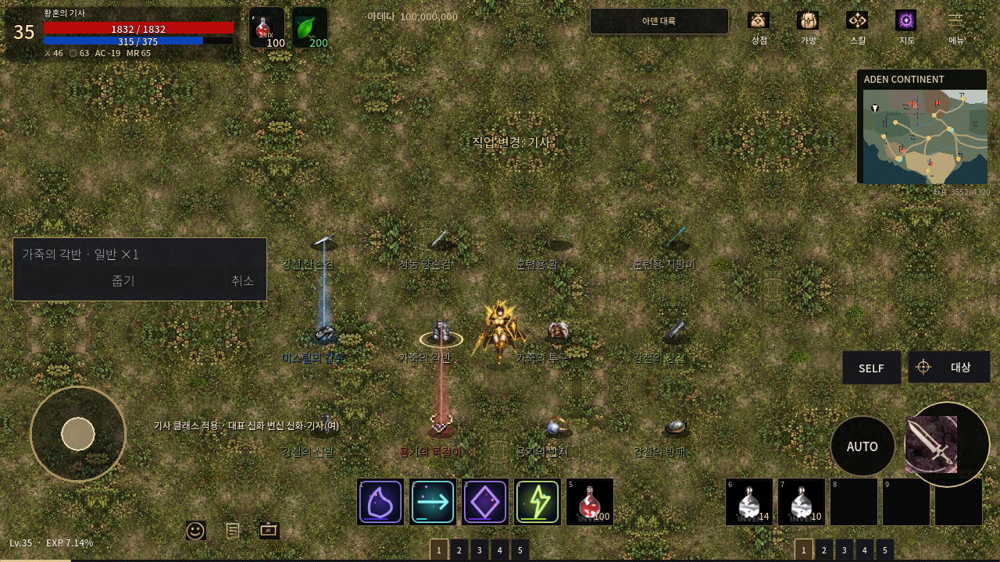
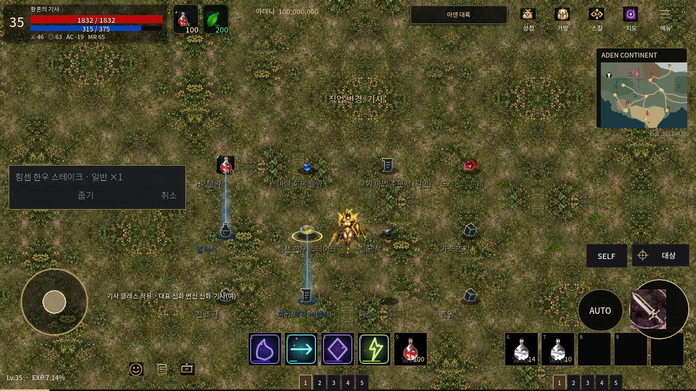
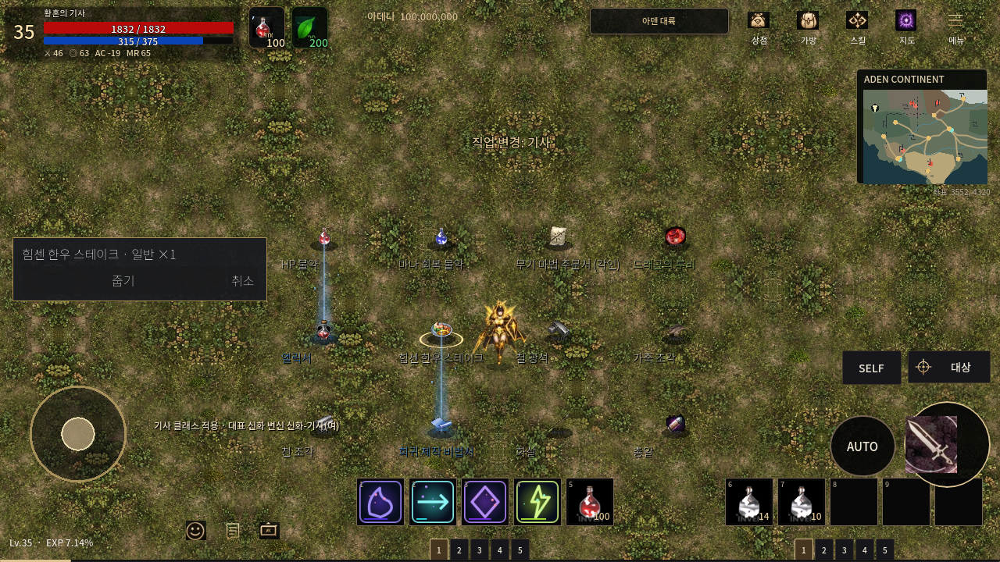

# 바닥 아이템 — 실제 Main 수정 전·후

동일한 테스트 장면에서 게임의 `Main.tscn`을 실행하고, 실제 드랍 객체와 기존 드랍 렌더러로 캡처했다. 새로운 게임 화면이나 3D 미리보기를 만든 것이 아니다.

표본을 식별하기 위해 각 아이템 아래에 붙인 이름 자막은 **검사 전용**이다. 게임의 원래 이름 표시 기능은 실제 선택 정보창과 툴팁으로 별도 검증하며 이 변경에서 수정하지 않는다. 선택된 항목의 실제 이름 정보창도 캡처에 포함된다.

## 장비 — 수정 전

## 장비 — 수정 후

검·양손검·활·지팡이·갑옷·각반·투구·장갑·신발·목걸이·반지·방패의 표본을 같은 위치에서 비교한다.

## 소모품과 재료 — 수정 전

## 소모품과 재료 — 수정 후

HP/MP 물약·주문서·드래곤 보석·엘릭서·음식·광석·가죽·천·제작서·화살·총알을 비교한다.

## 검증 자료

- [전체 연결 집계·전후 인벤토리 픽셀 비교 및 보호 파일 SHA-256](../ground_categories_20261015.json)
- [단계별 실제 엔진 실행 결과](test-summary.json)
- [전체 실행 로그와 전후 원시 결과 산출물](https://github.com/zoog136-hash/-/actions/runs/38655342601)
- [구현 방식과 유지보수](../../ground_category_icons_KO.md)

화면 캡처는 Linux OpenGL 소프트웨어 렌더러에서 실행한 결과이며 Android 실기기 성능이나 터치 하드웨어 검증을 대신하지 않는다. 종류별 대표 그림은 정확한 원작 개별 아이템 이미지라는 뜻이 아니다.
